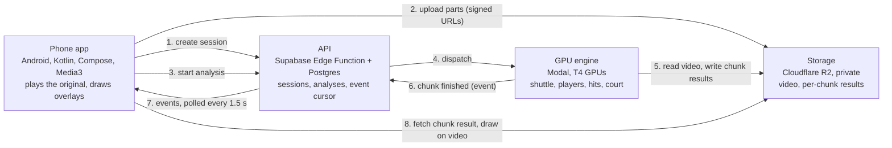

# Elevate 1.0 - racket-sports intelligence from one phone camera

Problem statement 02 (Elevate hackathon). Pick a badminton video from your phone gallery. It plays
at once while a cloud GPU engine analyses it, and the results are drawn on your own footage as
each 6-second chunk finishes: the shuttle's path, hit candidates, rally candidates and the court
lines. No model is trained or fine-tuned; the engine uses public pretrained networks plus geometry,
physics, audio and a rules engine.

Everything shown is real footage and real engine output. Anything the evidence cannot support is
withheld and labelled, not guessed.

Repository: https://github.com/darved2305/ggw_elevate. Submission text: [`docs/submission/SUBMISSION.md`](docs/submission/SUBMISSION.md). Demo script: [`demo/DEMO-SCRIPT.md`](demo/DEMO-SCRIPT.md).

## What works today (proven)

Each line links to the pull request or issue holding the real run, output or on-device evidence.
PR numbers are on https://github.com/darved2305/ggw_elevate/pull/N, issues on `/issues/N`.

| Capability | Proof |
|---|---|
| **Phone to cloud and back, live.** The app uploads the video to private cloud storage (resumable, 8 MiB parts). The GPU engine analyses it in ordered 6 s chunks and reports each chunk as it finishes; the app draws them on the video. Measured: a 484.5 s match video analysed in 626.6 s on up to 10 GPUs, 81 chunks, 81 accepted result events. On a Galaxy A55, a 25.6 s clip uploaded, analysed in 5 chunks and drew the engine's shuttle trail on the real video. | Upload API and storage with live end-to-end transcript: [#29](https://github.com/darved2305/ggw_elevate/pull/29). A55 upload to the deployed API: [#50](https://github.com/darved2305/ggw_elevate/pull/50). Engine on real uploads, every chunk reported: [#54](https://github.com/darved2305/ggw_elevate/pull/54). Live trail on the A55: [#74](https://github.com/darved2305/ggw_elevate/pull/74). |
| **Shuttle tracking.** A published shuttle-detection network (TrackNetV3, used as released) plus a motion-tracking layer. On 196 hand-labelled frames (153 with the shuttle visible, 15 px tolerance): precision 100%, recall 79.7%. Raw network output was 78.1% / 79.1%. Settings were chosen on this clip, so these are development numbers, not held-out numbers. | [#49](https://github.com/darved2305/ggw_elevate/pull/49), re-measured inside the full pipeline in [#54](https://github.com/darved2305/ggw_elevate/pull/54). Our port reproduces the official network frame for frame: [#22](https://github.com/darved2305/ggw_elevate/pull/22). |
| **Hit detection from audio plus trajectory.** 155 audio onsets and 32 hit candidates on 60 s of real play, checked by eye on frames: about 26 of 32 are racket contacts. There are no hand-labelled hits yet, so this is a visual check, not an accuracy figure. | [#58](https://github.com/darved2305/ggw_elevate/pull/58), live in every chunk in [#76](https://github.com/darved2305/ggw_elevate/pull/76). |
| **Court calibration from 4 taps.** On the real corner taps from a real A55 session, the engine computes the floor-plan mapping, reports quality grade B (position uncertainty 0.19 m; grade A needs 0.15 m or better) and the projected lines sit on the painted lines except the near service line (about 16 px low) and the centre line at the near baseline (about 18 px off). The app's own mapping from the same taps agrees with the engine's to within 1 cm across the court. | Engine: [#87](https://github.com/darved2305/ggw_elevate/pull/87); real taps: [#61](https://github.com/darved2305/ggw_elevate/issues/61); app vs engine agreement test: [#88](https://github.com/darved2305/ggw_elevate/pull/88). |
| **Badminton scoring rules, shared by server and app.** BWF law-cited rules (service, deuce, 30-point cap, end changes, doubles) with 45 test vectors. The TypeScript package, the server copy and the Kotlin port in the app all pass the same 45. | Rules and vectors: [#40](https://github.com/darved2305/ggw_elevate/pull/40). Server copy: [#70](https://github.com/darved2305/ggw_elevate/pull/70). Kotlin port: [#69](https://github.com/darved2305/ggw_elevate/pull/69). |
| **Court lines on the video, a top-down mini court, a hit and rally timeline, and corners placed outside the frame.** Merged and unit-tested (277 tests, 0 failures). On-device verification on the A55 is (in progress). | Merged together in [#78](https://github.com/darved2305/ggw_elevate/pull/78) from [#72](https://github.com/darved2305/ggw_elevate/pull/72), [#73](https://github.com/darved2305/ggw_elevate/pull/73), [#75](https://github.com/darved2305/ggw_elevate/pull/75). Device check: [#84](https://github.com/darved2305/ggw_elevate/issues/84). |
| **Free-tier-only cloud cost.** The API refuses uploads past 20% of the Cloudflare free tier, pauses automatically at 10%, and has a kill switch; the bucket deletes originals after 1 day. Modal spend has a $30 ceiling. | [`docs/ops/cloudflare-budget.md`](docs/ops/cloudflare-budget.md), [#14](https://github.com/darved2305/ggw_elevate/pull/14), [#15](https://github.com/darved2305/ggw_elevate/pull/15), guards live in [#29](https://github.com/darved2305/ggw_elevate/pull/29); Modal ceiling [#6](https://github.com/darved2305/ggw_elevate/pull/6). |

## Architecture



Video bytes never pass through the API. The phone plays its own original file. The engine never
writes the database directly; the API is the only writer of events. Data shapes live in
[`docs/plan/contracts.md`](docs/plan/contracts.md) and `packages/contracts`.

## Repo map

```
android/          the Android app (Kotlin, Compose, Media3)
engine/           the vision engine on Modal (Python): shuttle tracking, hits, audio, court calibration
supabase/         API (Edge Function), database migrations and tests
packages/         shared data schemas (contracts) and the badminton rules engine (rules + 45 test vectors)
fixtures/         real hand-labelled frames and one real engine result; clips.md pins every video by source and hash
services/ sdk/ mcp/   insights job, TypeScript SDK, read-only MCP server (developer platform)
docs/plan/        the plan, data contracts, architecture
docs/ops/         cost guard for cloud storage
docs/submission/  submission text and the hour-by-hour checklist
demo/             demo script and fallback notes
DECISIONS.md      every decision that changed the plan, a data shape or a rule
LEDGER.md         what landed on main (written by CI)
AGENTS.md         working rules for everyone, humans and coding agents
```

## How to run the demo

Full beat-by-beat script: [`demo/DEMO-SCRIPT.md`](demo/DEMO-SCRIPT.md).

1. **Backend (already deployed).** API: `https://zpwxjjsugujmihhkmfjx.supabase.co/functions/v1/api`
   (`GET /v1/health` returns `{"status":"ok"}`). Engine: deployed on Modal from `main`
   (`cd engine && modal deploy -m elevate_engine.modal_app`, owner only).
2. **App.** Build and install the debug APK on an Android phone (we use a Galaxy A55, Android 16).
   From `android/`, with `elevate.apiBaseUrl` set in the untracked `local.properties` (see
   [`android/README.md`](android/README.md)):
   ```sh
   ./gradlew assembleDebug
   adb install -r app/build/outputs/apk/debug/app-debug.apk
   adb shell am start -n com.elevate.app/.MainActivity
   ```
3. **Footage.** Real clips, pinned by source and hash in [`fixtures/clips.md`](fixtures/clips.md) and
   [`android/proof/video-manifest.md`](android/proof/video-manifest.md). Copy one onto the phone
   (we use `eurogames_bern_1.webm`, 25.6 s, CC BY-SA 4.0, from Wikimedia Commons).
4. **Run.** Open the app, pick the clip, tap the four court corners, tap Analyse match. The upload,
   the analysis stages and the live shuttle trail appear on screen. A cold engine takes about
   2 minutes to start; we keep one container warm during the demo window.
5. **Fallback.** If the live run is slow, open the result analysed earlier (labelled "analysed
   earlier" in the app).

Tests (what CI runs): `pnpm -r test` (contracts and rules), `cd engine && uv run pytest -q`,
`cd android && ./gradlew assembleDebug lintDebug testDebugUnitTest`, `deno test` under
`supabase/functions`.

## What is next

Not done yet, in order of importance for the demo:
- The engine does not yet close an analysis (the final step that writes the match record), so the
  overview has no rallies, score or landings from a live run: [#79](https://github.com/darved2305/ggw_elevate/issues/79), [#82](https://github.com/darved2305/ggw_elevate/issues/82).
- Court calibration and per-player positions are built and proven on real taps, but not yet merged
  or wired into the live result: [#80](https://github.com/darved2305/ggw_elevate/issues/80).
- Line-call estimates (shuttle landing IN, OUT or too close to call) need calibration in the live
  result first; they are not shown today.
- Confirm-and-score in the app (a player confirms each point, the rules engine updates the score):
  server route in progress, [#83](https://github.com/darved2305/ggw_elevate/issues/83).
- Held-out accuracy: shuttle tracking is scored only on the clip it was tuned on; a second,
  untouched segment is labelled for the held-out test and has not been scored yet.
- Only badminton has a working tracker; other racket sports are planned, not built.

## Contributing

Rules for every contributor, human or coding agent, are in [`AGENTS.md`](AGENTS.md): nothing
synthetic, real proof for every change, decisions recorded before plan or data-shape changes. Work
in small slices straight to `main`; CI (`ci-gate`) must be green. Open audit findings:
[`docs/AUDIT-FINDINGS.md`](docs/AUDIT-FINDINGS.md). Each person's brief is in `docs/lanes/`.

Repository owner: on GitHub Free a private repo cannot require checks, enforce CODEOWNERS or
auto-merge. With GitHub Pro (free for verified students): Settings, Branches, protect `main`,
require the `ci-gate` check and pull requests, enable auto-merge and automatic branch deletion.
Until then the rules are honour-based and CI results are advisory.
