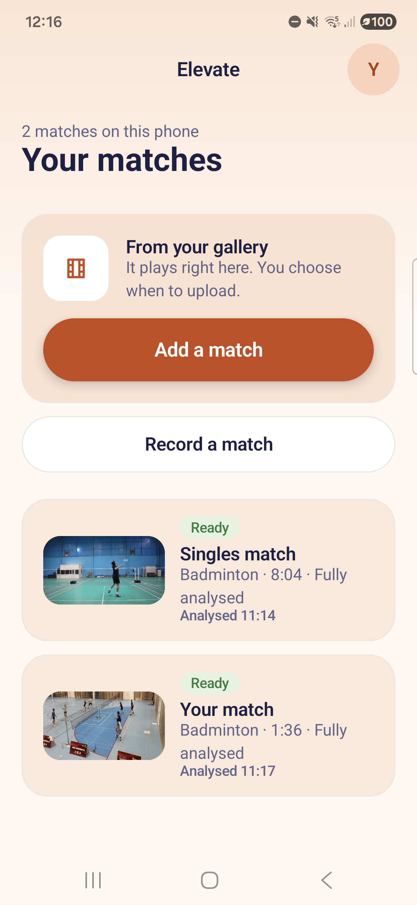
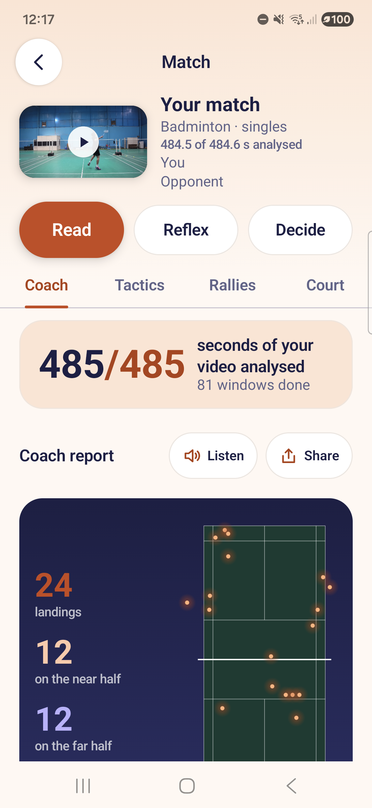
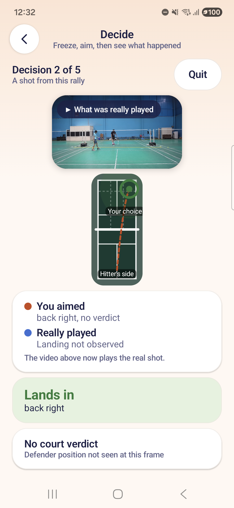
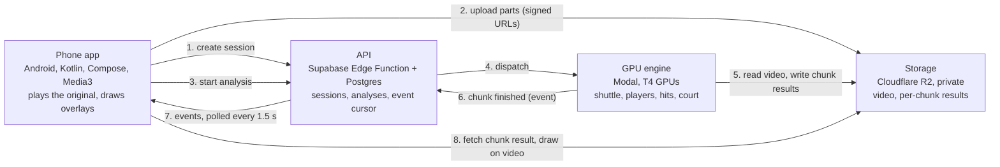

# Deuce

Racket-sports analysis from one phone camera. Pick a badminton match video from your phone's gallery.
It plays right away while a cloud GPU engine analyses it, and the results are drawn on your own
footage as each 6-second chunk finishes: the shuttle's path, hit candidates, rally candidates, court
lines and a top-down map. No model is trained or fine-tuned. The engine uses published pretrained
networks plus geometry, audio and a rules engine.

This repository is our submission for **Elevate 1.0** (hackathon problem statement 02). The Android
app inside it is called **Elevate**. Everything shown is real footage and real engine output, and
anything the evidence cannot support is withheld and labelled, not guessed.

<p align="center">
  
  
  
</p>
<p align="center"><sub>Screenshots from a Galaxy A55 running the real build. See <a href="#footage-and-credits">footage and credits</a> for where the footage comes from.</sub></p>

**Contents:** [What it does](#what-it-does) · [What is measured](#what-is-measured) · [How it works](#how-it-works) · [Repo map](#repo-map) · [Run it](#run-it) · [For developers](#for-developers) · [Limits](#limits-and-whats-not-done) · [Contributing](#contributing) · [Footage and credits](#footage-and-credits)

## What it does

- **Plays your video at once.** The phone plays the original file. Video bytes never pass through the API; the engine reads them from private storage.
- **Draws results on the real frames.** Shuttle trail, hit and rally candidates, court lines from four corner taps, and landing marks. Every number shows its denominator, for example "485 of 485 seconds analysed".
- **Withholds what it cannot support.** Line calls are `MODEL ESTIMATE` (IN, OUT, TOO CLOSE TO CALL, UNOBSERVED) and the score changes only when a player confirms a point.
- **Coaches from your own match.** A Coach report, a tactics view, and three training modes built on your real shots: Read, Reflex and Decide ([#127](https://github.com/darved2305/ggw_elevate/pull/127), [#137](https://github.com/darved2305/ggw_elevate/pull/137), [#149](https://github.com/darved2305/ggw_elevate/pull/149)).
- **Records live.** Pieces upload while you record and analysis starts early ([#153](https://github.com/darved2305/ggw_elevate/pull/153), [#162](https://github.com/darved2305/ggw_elevate/pull/162)).
- **Exposes the same match record to developers** through a REST API, a TypeScript SDK and a read-only MCP server ([below](#for-developers)).

## What is measured

Each line links to the pull request or issue that holds the real run, output or on-device evidence.
These are the numbers recorded when the work landed (2026-10-10 to 2026-10-11). They were not re-run
for this README.

| Capability | Result | Evidence |
|---|---|---|
| Phone to cloud and back | A 484.5 s match video was analysed in 626.6 s on up to 10 GPUs: 81 chunks, 81 accepted result events. On a Galaxy A55, a 25.6 s clip uploaded, was analysed in 5 chunks and drew the engine's shuttle trail on the real video. | [#29](https://github.com/darved2305/ggw_elevate/pull/29), [#50](https://github.com/darved2305/ggw_elevate/pull/50), [#54](https://github.com/darved2305/ggw_elevate/pull/54), [#74](https://github.com/darved2305/ggw_elevate/pull/74) |
| Shuttle tracking | TrackNetV3 as released, plus a motion-tracking layer. On 196 hand-labelled frames (153 with the shuttle visible, 15 px tolerance): precision 100%, recall 79.7%. Raw network output was 78.1% / 79.1%. Settings were chosen on this clip, so these are development numbers, not held-out numbers. Our port reproduces the official network frame for frame. | [#49](https://github.com/darved2305/ggw_elevate/pull/49), [#54](https://github.com/darved2305/ggw_elevate/pull/54), [#22](https://github.com/darved2305/ggw_elevate/pull/22) |
| Hits from audio and trajectory | 155 audio onsets and 32 hit candidates on 60 s of real play. About 26 of 32 looked like racket contacts when checked by eye on frames. There are no hand-labelled hits yet, so this is a visual check, not an accuracy figure. | [#58](https://github.com/darved2305/ggw_elevate/pull/58), [#76](https://github.com/darved2305/ggw_elevate/pull/76), [#118](https://github.com/darved2305/ggw_elevate/pull/118) |
| Court from 4 taps | On real taps from a real A55 session the engine reports quality grade B (position uncertainty 0.19 m; grade A needs 0.15 m or better). Projected lines sit on the painted lines except the near service line (about 16 px low) and the centre line at the near baseline (about 18 px off). The app's own mapping agrees with the engine's to within 1 cm. | [#87](https://github.com/darved2305/ggw_elevate/pull/87), [#61](https://github.com/darved2305/ggw_elevate/issues/61), [#88](https://github.com/darved2305/ggw_elevate/pull/88) |
| Badminton scoring rules | BWF-law-cited rules (service, deuce, 30-point cap, end changes, doubles) with 45 test vectors. The TypeScript package, the server copy and the Kotlin port all pass the same 45. | [#40](https://github.com/darved2305/ggw_elevate/pull/40), [#69](https://github.com/darved2305/ggw_elevate/pull/69), [#70](https://github.com/darved2305/ggw_elevate/pull/70) |
| Finalize, players, landings | The engine closes an analysis (writes the match record), calibrates the court inside it, tracks players in court metres and proposes landing candidates. | [#94](https://github.com/darved2305/ggw_elevate/pull/94), [#96](https://github.com/darved2305/ggw_elevate/pull/96), [#97](https://github.com/darved2305/ggw_elevate/pull/97), [#106](https://github.com/darved2305/ggw_elevate/pull/106) |
| Handheld stabilisation | Measured on real handheld footage and kept off. | [#168](https://github.com/darved2305/ggw_elevate/pull/168) |
| Cost | Cloud storage is capped at 20% of the Cloudflare free tier in code, with an automatic pause at 10% and a kill switch. Modal spend has a $30 ceiling. A later change made analysis 39% cheaper per match. | [`docs/ops/cloudflare-budget.md`](docs/ops/cloudflare-budget.md), [#15](https://github.com/darved2305/ggw_elevate/pull/15), [#6](https://github.com/darved2305/ggw_elevate/pull/6), [#172](https://github.com/darved2305/ggw_elevate/pull/172) |

The rules every contributor follows to keep these claims honest are in [`AGENTS.md`](AGENTS.md).

## How it works



The engine never writes the database; the API is the only writer of events. Data shapes are
defined once in [`docs/plan/contracts.md`](docs/plan/contracts.md) and `packages/contracts`.

What the engine does, and what it deliberately does not:

- **Shuttle:** TrackNetV3 (a published shuttle-detection network) plus Kalman tracking with gated matching that removes false detections such as the back-wall spot.
- **Hits:** audio onsets (sudden jumps in sound energy) fused with direction changes in the tracked path, after correcting the audio lag.
- **Court:** a projective mapping from the picture to the floor plan from four taps. Corners may sit outside the frame.
- **Players:** a detector (D-FINE) with stable ids across windows and positions in metres on the court.
- **Not done by models:** scoring. A rules engine applies BWF law to events the player confirms.

## Repo map

```
android/          Android app "Elevate" (Kotlin, Jetpack Compose, Media3)
engine/           vision engine on Modal (Python): shuttle, hits, audio, court, players, finalize
supabase/         API (Edge Function), Postgres migrations, tests
packages/         contracts (zod + JSON Schema) and the badminton rules engine with its 45 vectors
sdk/              generated TypeScript SDK
mcp/              read-only MCP server (10 tools)
services/         insights job
web/dev-site/     developer landing page and API reference (OpenAPI spec, 29 routes)
fixtures/         real hand-labelled frames, one real engine result, pinned footage list
docs/             plan, contracts, ops, research, business case, submission text
demo/             demo script
DECISIONS.md      every decision that changed the plan, a data shape or a rule
LEDGER.md         what landed on main (written by CI)
```

## Run it

**Offline, no accounts.** The commands below are copied from the CI workflow
([`.github/workflows/ci.yml`](.github/workflows/ci.yml)) and the component docs; the MCP server has
its own `npm` project:

```sh
pnpm install --frozen-lockfile && pnpm -r --if-present run test   # contracts and rules (45 vectors)
cd engine && uv sync --locked && uv run pytest -q                 # engine
cd supabase/functions && deno test --allow-all                    # API routes
cd mcp && npm ci && npm test                                      # MCP server
cd android && ./gradlew assembleDebug lint test                   # app
```

**Backend.** The app needs a Supabase project (API and Postgres from `supabase/`), a Cloudflare R2
bucket and a Modal deployment (`cd engine && modal deploy -m elevate_engine.modal_app`). During the
hackathon these ran as a hosted service. The hosted Supabase address used in earlier versions of this
README no longer resolves in DNS (checked 2026-11-03), so a new checkout needs its own project;
variable names are in [`.env.example`](.env.example). The cost guards in
[`docs/ops/cloudflare-budget.md`](docs/ops/cloudflare-budget.md) apply to whichever account you use.

**App.** Build the debug APK as described in [`android/README.md`](android/README.md), with
`elevate.apiBaseUrl` set in the untracked `android/local.properties`. The full demo walk-through is
[`demo/DEMO-SCRIPT.md`](demo/DEMO-SCRIPT.md).

## For developers

The same `match.v1` record the app reads is available three ways:

- **REST API:** 29 routes, spec in [`web/dev-site/openapi.json`](web/dev-site/openapi.json), reference in [`docs/lanes/person-3-api.md`](docs/lanes/person-3-api.md).
- **TypeScript SDK:** generated from the spec ([`sdk/`](sdk/README.md)); [`sdk/examples/analyse.ts`](sdk/examples/analyse.ts) goes from a video file to a finished analysis.
- **MCP server:** [`mcp/`](mcp/AGENTS.md) exposes 10 read-only tools, so an assistant can ask what the engine detected and how sure it is. Every count carries its denominator. A rehearsed walk-through is in [`mcp/FINALS-SHOWCASE.md`](mcp/FINALS-SHOWCASE.md).

## Limits and what's not done

- **Not held-out.** Shuttle tracking was tuned and scored on the same clip. A second, untouched segment is labelled for a held-out test; no score for it is recorded in this repo.
- **Hits are candidates.** There are no hand-labelled hits, so no accuracy figure exists yet.
- **Badminton only.** Other racket sports are planned; only badminton has a working tracker.
- **One fixed camera.** The tracker assumes a steady camera. Stabilisation for handheld footage was tried and left off.
- **No known hosted backend.** See [Run it](#run-it): you need your own.
- **Court grade B.** Calibration on the real taps is grade B, not A.

Open work is tracked as [issues](https://github.com/darved2305/ggw_elevate/issues) and in
[`docs/AUDIT-FINDINGS.md`](docs/AUDIT-FINDINGS.md). The business case is in
[`docs/business/BUSINESS.md`](docs/business/BUSINESS.md).

## Contributing

Read [`CONTRIBUTING.md`](CONTRIBUTING.md). The short version: nothing synthetic, real proof for every
change, decisions recorded before plan or data-shape changes, small slices, `ci-gate` green.
Security reports: [`SECURITY.md`](SECURITY.md).

## Footage and credits

- **Footage.** Real clips are pinned by source and hash in [`fixtures/clips.md`](fixtures/clips.md) and [`android/proof/video-manifest.md`](android/proof/video-manifest.md); videos are not in git. The demo clip is a YouTube match video whose licence is not tracked; the other clips come from Wikimedia Commons under CC BY or CC BY-SA, with links in the manifest.
- **Models.** [TrackNetV3](https://github.com/qaz812345/TrackNetV3) (shuttle detection), [D-FINE](https://github.com/Peterande/D-FINE) (players, Apache-2.0), [TAPIR](https://github.com/google-deepmind/tapnet) (Apache-2.0). No weights are stored in git.
- **Team.** Four people in four lanes: [@VrajVed](https://github.com/VrajVed) (vision engine), [@darved2305](https://github.com/darved2305) (Android app and UI), [@nikhilpravinpise](https://github.com/nikhilpravinpise) (API, data, SDK, MCP), [@HetanshWaghela](https://github.com/HetanshWaghela) (repo, CI, contracts, rules, eval, demo).
- **Licence.** No licence file has been added yet, so all rights are reserved until the owners choose one.
