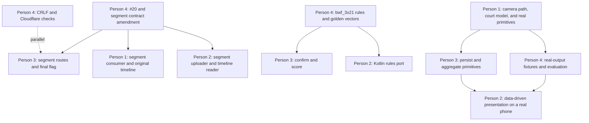

# 13 · Additional plan: more signal from the same real footage

> **Status: proposed reference (D-261011-HW9), not yet adversarially reviewed.** Tonight's priority is the live demo path; use this after the demo is safe.

This is a proposed queue update for all four lanes. It adds camera-motion robustness and richer
inferences to slices already planned. It does not mark any capability as verified. Tier A is core
work in Phases 2–3, Tier B is Phase 4, and Tier C is only if time remains. All thresholds below
are starting criteria, not measured product results. Tune them on development clips only. Never
tune on the held-out segment.

Evidence abbreviations used below:

- `01` means `docs/plan/01-ps-fundamentals.md` and its named PS rows.
- `P1 #22` and `P1 #24` mean `research/out/plan-context/pr22-person1.md` and
  `research/out/plan-context/pr24-person1.md`, respectively.
- `S1` means `research/out/S1-stabilisation-findings.md`.
- `Roadmap` means `research/out/engine-roadmap/roadmap.md`.
- `P3 state` and `#20` mean `research/out/plan-context/issue26-person3-status.md` and
  `research/out/plan-context/issue20-contract-gaps.md`.
- `Inference menu` means `research/out/plan-context/inference-table.md`.

## Dependency order

The first unblock is Person 4's contracts amendment. The order keeps implementation in each
owner's lane and lets independent queue work continue while contracts are reviewed.

Person 1 should finish the real baseline and make the first real window available before the
camera-path comparisons. Person 4 can prepare schemas, rules, and labelled development material
while that work runs. Person 3 can continue the existing persistence queue while the contract
amendment is reviewed. Person 2 continues the Phase 2 app flow against the current fixture and
deployed health route, then switches to the real catalog once those artifacts exist.

## Person 1 · @VrajVed · engine and Modal

### Current queue

- **Done as reported:** PR #22 ports TrackNetV3 and matches the official tracking-module output on
  all 12,656 `stdata_test` frames. This proves method fidelity on the authors' test split, not
  phone footage. [P1 #22]
- **Done as reported:** PR #24 runs TrackNet candidates on the real `h13g_singles` working clip.
  Its reported precision, recall, and F1 are 71.5%, 82.2%, and 76.5% against the current
  hand-labelled working fixture. The contact sheet shows the top candidate fixed on one back-wall
  spot in several frames. [P1 #24]
- **Still to reconcile:** the PR #24 report says the wider 31–91 second run was still running when
  it opened. Current code has `Models.track`, `track_clip`, `frames_in_range`, `audit_clip`, and a
  stub `analyze`; it does not yet have a camera path, tracking layer, player detector, or real
  `/internal` output path. Treat the wider run and end-to-end result as `UNVERIFIED` until its
  Modal output is recorded. [P1 #24; `engine/elevate_engine/modal_app.py`]
- **Existing Phase 2 queue:** a real one-window `/internal` post, tap calibration, player detection
  and association, tracking, audio onsets, hit and landing candidates. **Phase 3:** finalizer,
  ordered segments, state carry, and real clips. The sequence below keeps those slices and inserts
  the additions at their dependency points. [`10` §3; `docs/lanes/person-1.md`]

### Tier A additions

#### A1. Always-on camera path, with identity for a fixed camera

- **Slot:** after the wider working-clip baseline is closed, before the first one-window detector
  result. It replaces a motion-gated branch: every frame gets a path record, and a fixed camera
  produces the identity transform.
- **Why:** PS C2 asks for analysis from one normal camera and PS T4 requires a useful trail. The
  supplied handheld audit reports motion across its clips, while S1 recommends KLT with ORB and
  court re-anchoring. The stabilization values in S1 and the Inference menu do not agree, so neither
  is an acceptance result. [01 §A/C2, §B/T4; S1; Inference menu]
- **What and method:** decode once. At half resolution, seed court-ROI features with
  `cv.goodFeaturesToTrack`; track with forward and backward `cv.calcOpticalFlowPyrLK`; reject
  failed or inconsistent tracks; fit frame-to-frame court support with
  `cv.findHomography(..., cv.RANSAC, ...)`; re-anchor using `cv.ORB_create`,
  `cv.BFMatcher.create(cv.NORM_HAMMING)`, and court-line correspondences. Accumulate transforms
  into one stable reference. Smooth projected court corners, never raw matrix coefficients. Run
  the path stage on every frame. If the robust motion estimate stays at or below 0.25
  848-equivalent pixels per frame and 2 pixels in a one-second block, label the result `identity`
  and emit the identity matrix for each frame; the thresholds classify a static path and do not
  skip the stage. Re-anchor every 0.5–1 second or sooner when support degrades. These are S1
  starting values, not validated thresholds. [S1; Roadmap §2; OpenCV 4.13 docs linked in
  `person-1-spec.md`]
- **Inputs and outputs:** source frame, `frame.pts`, stream `time_base`, upright source dimensions,
  court ROI or tap seed. Emit `camera_path.v1` at
  `analysis/{analysis_id}/{engine_version}/tracks/camera_path.json`, with
  `reference_frame_index`, `reference_t_ms`, `source_width_px`, `source_height_px`,
  `rotation_deg`, `coordinate_frame`, and per-frame `frame_index`, `t_ms`,
  `source_to_stabilized_3x3`, `method`, `status`, `candidate_count`, `inlier_count`, `inlier_ratio`,
  `reprojection_median_px`, `reprojection_p95_px`, `spatial_coverage`, `valid_fraction`, and
  heuristic `path_confidence`. Person 4 adds the schema; Person 3 registers it as an artifact.
- **Contract change:** new `camera_path.v1`, registry and JSON Schema; artifact kinds
  `camera_path` and its deterministic key; optional `analysis.artifacts.camera_path` in `match.v1`.
  Separate contract PR, additive minor version, all-four sign-off.
- **Real proof bar:** use a fixed real clip as the identity control and real handheld development
  clips with manually selected court points. Require median path reprojection at or below 1
  848-equivalent pixel and at least 80% valid court overlap, with at least 30 inliers and a 0.25
  inlier ratio. Report p50/p95, finite-transform fraction, valid court area, drift, CPU time, and
  peak memory. The Roadmap's 85% valid-area target is a stricter candidate; do not reinterpret it
  as a frame-coverage threshold. Keep `h13g_singles` 300–360 seconds untouched until held-out
  evaluation.
  [S1 decision-ready; Roadmap §2 and §4; `fixtures/clips.md`]
- **Dependencies:** Person 4 supplies a rights-cleared handheld development clip and court-point
  labels; Person 4 owns the schema; Person 3 registers the artifact; Person 2 later consumes it.
- **Risk and fallback:** a court homography cannot correct rolling shutter, radial distortion,
  or parallax above the floor plane. On weak support, emit `failed` or `low_confidence`, keep the
  original frame, and withhold stabilization-dependent geometry. Never reuse a prior transform as
  a fresh success. [S1; Roadmap §2]
- **Cost:** CPU geometry only. Start with the existing T4 class at `cpu=4` and an explicit 4 GiB
  memory request, then measure. The research estimate is not a Modal timing result. No new model
  weights. Stay under the project-wide $30 Modal ceiling; the actual regional multiplier is
  `UNVERIFIED`. [`engine/elevate_engine/modal_app.py`; S1; Roadmap §5; D-261010-VV1]

#### A2. Court model carried through the camera path, with partial-view abstention

- **Slot:** after A1 and before the first shuttle inference. Keep the four named taps as an
  initializer, then refine and carry the model through the camera path.
- **Why:** PS C1 and T5 call for court dimensions and useful player statistics; the current
  `h13g_singles` view likely omits the near baseline, so its calibration must abstain. [01 §A/C1,
  §B/T5; `fixtures/clips.md` §`h13g_singles`]
- **What and method:** map the tapped `near_left`, `near_right`, `far_right`, `far_left` points to
  the selected `court_templates` coordinates. Use `cv.Canny` followed by
  `cv.HoughLinesP` at the OpenCV tutorial starting values `rho=1`, `theta=pi/180`,
  `threshold=50`, `minLineLength=50`, `maxLineGap=10`; also compare
  `cv.createLineSegmentDetector` defaults. Cluster line directions, intersect line candidates,
  and robustly refine correspondences with `cv.findHomography` and its documented RANSAC defaults
  of 3 pixels, 2,000 iterations, and 0.995 confidence. Accumulate evidence in stable-reference
  coordinates. Only publish court metres when the template and scale are uniquely constrained;
  otherwise publish supported image-space lines and `tier: C`. Store `calibration.H` in the
  image-to-surface direction used by `07` §3; court-metre points are obtained from stable-image
  pixels, never by applying the matrix to airborne shuttle points. Values are starting engineering
  settings, not measured accuracy. Tune on development clips only. [contracts §2 and §9; S1;
  OpenCV 4.13 docs linked in `person-1-spec.md`]
- **Inputs and outputs:** `session_spec.calibration_input`, `camera_path.v1`, sport and format.
  Update `match.v1.calibration.H`, `H_cov`, `residual_px`, `visible_fraction`, and `tier`; add
  per-frame supported court geometry to `timeline.v1` as `court_model` data. Do not fabricate
  hidden corners.
- **Contract change:** `timeline.v1`; optional calibration quality fields only if the current
  calibration object cannot carry measured residual and visibility. Person 4 decides in the
  separate contract PR.
- **Real proof bar:** on a full-view and a real partial-view clip, measure reprojection error on
  withheld real line intersections and the fraction of frames with a correct A/B/C tier. Pass
  when no partial-view frame reports Tier A without scale support and the withheld-point median
  residual is at most 1 source pixel at the 848-equivalent processing scale. Thresholds tune on
  development clips only. [`04` §2/§4; `07` §3; S1]
- **Dependencies:** A1; Person 4's sport templates and hand-marked validation intersections.
- **Risk and fallback:** parallel lines, glare, occlusion, and wrong court-template matches can
  produce a plausible wrong matrix. Fall back to the named taps or image-space-only lines; mark
  court metres unavailable.
- **Cost:** CPU only and no additional R2 object beyond the path and timeline artifacts. Any
  actual Modal runtime and artifact bytes remain `UNVERIFIED`; obey the $30 cap and Cloudflare
  limits in `docs/ops/cloudflare-budget.md`.

#### A3. Stabilized court crop and a temporal filter for the back-wall false positive

- **Slot:** after A2, before the current sampled-player slice. This is the new shuttle stage in the
  prescribed engine order.
- **Why:** PR #24 reports a repeated static back-wall candidate and 71.5% precision, 82.2% recall,
  76.5% F1 on the real working labels. PS T4 asks for a real shuttle trail. [P1 #24; 01 §B/T4]
- **What and method:** warp source frames to the stable court reference with `cv.warpPerspective`;
  warp a valid-pixel mask in parallel; crop the supported court at native resolution before the
  current 512×288 TrackNet input resize. Compute the background median from valid pixels only.
  Current `tracknet.run.background()` uses `max_samples=300`, but its floor-stride can exceed
  that count; fix it to choose at most 300 evenly spaced valid frames. Keep the
  checkpoint's eight-frame sequence length, heatmap threshold 0.5, all connected candidates, and
  the current batch size of 16. Map every candidate through the inverse path before emitting
  source-image coordinates. [`engine/elevate_engine/tracknet/infer.py`, `tracknet/run.py`,
  `tracknet/model.py`; `04` §2; S1 §3]
- **Tracking and rejection:** run a constant-velocity Kalman tracklet on real PTS deltas; associate
  with a Mahalanobis gate and heatmap score. Start with the existing design rule of at most one
  missing slot interpolated, rendered dashed and excluded from metrics, events, and calls. Add a
  persistent-background penalty only when a candidate repeatedly lands on the same stabilized
  background location without a consistent incoming or outgoing track. The first gate threshold
  is `UNVERIFIED`; tune only on development labels. Keep candidate rows if the filter cannot
  distinguish a slow shuttle from a static spot. [`04` §2; `docs/lanes/person-1.md`; S1 §3]
- **Inputs and outputs:** `camera_path.v1`, court crop, real source frames and PTS, verified
  `tracknet_v3` checkpoint. Emit current `window_result.v1.ball` rows
  `[t_ms,x_px,y_px,confidence,state]`; add tracklet IDs and candidate diagnostics to
  `timeline.v1`, not to a guessed tuple extension.
- **Contract change:** `timeline.v1` and the artifact references. `window_result.v1` remains
  unchanged unless Person 4 approves a separately named additive field for tracking diagnostics.
- **Real proof bar:** compare raw plus raw median with stabilized plus valid median on the same
  labelled real frames. On the working `h13g_singles` labels, require at least 30% fewer false
  positives while losing no more than 5 percentage points of recall versus the PR #24 baseline.
  Report P/R/F1, false positives per minute, false-positive class, localization error, and contact
  sheets. The 30%/5-point values are S1 experiment targets, not achieved results. Repeat on real
  handheld development footage. Never tune on `h13g_singles` 300–360 seconds. [P1 #24; S1 §5;
  Roadmap §4]
- **Dependencies:** A1, A2, a rights-cleared handheld dev clip, and unchanged PR #22 method
  fidelity. Person 4 supplies labels; Person 2 consumes source-pixel output.
- **Risk and fallback:** warping can resample away a small shuttle and a moving camera can change
  valid background coverage. If the A/B run regresses recall or court coverage, keep the raw
  TrackNet candidates and label the stabilized path unavailable for that window.
- **Cost:** no additional model or GPU type. TrackNet remains on one T4; CPU warping overlaps with
  the next window only after profiling. The valid median adds bounded CPU memory, not a new R2
  object. Stop experiments before the $30 Modal cap; artifact writes stay within G8 and G5.
  [Roadmap §5; `docs/ops/cloudflare-budget.md`]

#### A4. Sampled players after shuttle tracking

- **Slot:** after A3, before hit, rally, and finalizer slices. Run the player detector on sampled
  frames; it is not required to seed the first camera path.
- **Why:** PS T5 asks for player statistics and the inference menu asks for measured player
  movement. The plan already pins D-FINE-S COCO at 640 input and 10–15 samples per second.
  [01 §B/T5; `04` §2; `docs/lanes/person-1.md`]
- **What and method:** run `dfine_s_coco` on 640-pixel model input, sampling at 10 frames per
  second as the initial value within the plan's 10–15 range. Associate detections across samples
  by box overlap and predicted center displacement; start with IoU at least 0.2 and displacement
  at most half a box diagonal. These association gates are unmeasured, dev-only starting values.
  Project the foot point to court metres only when the calibration tier permits it. The exact
  checkpoint hash and Apache-2.0 license remain the current manifest values.
- **Inputs and outputs:** upright source frames, `camera_path.v1`, `match.v1.calibration`, and
  `dfine_s_coco`. Emit current `window_result.v1.players` rows
  `[t_ms,track_id,x1,y1,x2,y2,foot_x_m,foot_y_m,confidence]`; add association status and identity
  switch evidence to `timeline.v1`. A tap anchors `who_is_me`; never auto-confirm identity.
- **Contract change:** `timeline.v1`; amend the player tuple to allow unavailable `foot_x_m` and
  `foot_y_m` for an uncalibrated frame, or define another explicit unsupported form. Add
  confidence/provenance only through Person 4's separate amendment. No new route.
- **Real proof bar:** on a consented real doubles development clip, hand-label boxes and
  identities. Report box precision/recall, ID switches per minute, and foot-point error; do not
  publish metre movement if calibration is weak. Pass when identity switches are explicitly
  flagged and no uncalibrated foot point is emitted as metres. The labeled clip and all thresholds
  remain dev-only until the held-out set is frozen. [`04` §2; Roadmap §4]
- **Dependencies:** A1/A2; Person 4's real doubles box and identity labels. P3 later stores the
  emitted tracks and aggregates.
- **Risk and fallback:** crossings, occlusion, and similar clothing can swap IDs. Keep anonymous
  track IDs, mark identity uncertain, and ask the player to confirm. Do not turn a person box into
  a confirmed player record.
- **Cost:** sampled D-FINE uses the existing T4 image and approved COCO weights; no new service.
  Measure actual PyTorch T4 time because the research TensorRT figure does not predict this build.
  Keep one T4 and the agreed spend guard. [Roadmap §3 and §5; D-261010-VV1]

#### A5. Hit, rally, and shot primitives from audio plus motion

- **Slot:** after A3 and A4, before `finalize`. This keeps event inference downstream of both the
  shuttle track and player positions.
- **Why:** PS T1/T3/I1/I4 ask for a match record, flight time, progressive analysis, and coaching.
  The plan describes audio spectral-flux onsets and trajectory changes near a player as candidate
  cues. [`01` §B/T1/T3, §D/I1/I4; `03` §3; `04` §2]
- **What and method:** decode the source audio with PyAV and calculate positive spectral flux on
  overlapping windows. Emit an onset as a candidate, never a confirmed hit. Join an onset to a
  shuttle direction change and a nearby player track within a provisional 100 ms association
  radius; start with a 45-degree direction change. These are unmeasured starting rules; tune only
  on dev clips. Use the sport-pack rally-gap rule when Person 4 supplies it. Until that rule is
  agreed, leave rally boundaries as candidates for user merge/split. Shot family stays `unknown`
  unless the geometry rule and its evidence support a candidate label.
- **Inputs and outputs:** original audio PTS, A3 ball tracklets, A4 player tracks, sport, format,
  and optional current `session_spec.rally_candidates`. Emit `window_result.v1.onsets` and
  `events` with `event_id`, `type`, `t_ms`, `t_sigma_ms`, `track_id`, `image_xy`, `cues`, and
  `state`; final records use `match.v1.events`, `shots`, and `rallies` fields already in contracts.
  Observed flight time is `shots.flight_time_ms` with `flight_time_state`; do not emit km/h.
- **Contract change:** optional typed `shot_family_confidence` and `shot_family_evidence` only if
  the current `shots.chosen.family` plus provenance cannot represent the candidate. Add the fields
  only through Person 4's separate amendment. Make `shots.flight_time_ms` optional or nullable
  until both observed hit and landing endpoints exist; keep `flight_time_state` explicit.
  `timeline.v1` indexes event evidence.
- **Real proof bar:** Person 4 labels hit times and rally boundaries on consented real development
  clips. Report hit precision/recall/F1, hit-time error in frames, and rally boundary error. The
  trail fixture alone cannot pass this bar because it has no hit labels. No values from these
  clips may tune the held-out set. [Roadmap §3–4; `fixtures/fixture_trail.json`]
- **Dependencies:** A3/A4 and Person 4's hit/rally labels and sport-pack gap rule. P3 persists
  events; P2 displays candidates and evidence frames.
- **Risk and fallback:** echoes and quiet strokes make audio unreliable; a shuttle turn alone can
  be a missed detection. Require corroborating cues for stronger labels, but do not use a fixed
  cue vote as confidence. Withhold the event if its observed evidence is weak.
- **Cost:** CPU signal processing and geometry only, using the same source read and T4 allocation.
  There is no LLM and no additional checkpoint. Stay within the $30 Modal cap.

#### A6. Carry geometry and tracking state through segments

- **Slot:** after the real one-window path is posted and before Person 2's Phase 3 segmented upload
  is integrated. Person 1's segment consumer stays adjacent to the existing ordered-window
  processor.
- **Why:** chunked real-time analysis is already core in Phase 3; the current code decodes a range
  into a list and PR #24 review calls out the need to chunk long ranges. The engine must preserve
  original PTS and TrackNet context across boundaries. [D-261011-HW3; `03` §2; P1 #24]
- **What and method:** use one ordered analysis worker. Keep only the active six-second window,
  0.5–1 second overlap, TrackNet's eight-frame context, and a bounded sample of valid background
  frames. Carry `camera_path` reference and last transform, KLT feature points, court model,
  active Kalman tracklets, player associations, background sample PTS, and `last_emitted_pts_us`
  across segment boundaries. Process overlap for context but emit only `emit_range_us`. On a
  worker failure, stop visibly and emit `analysis.failed`; never silently reset path or state.
- **Inputs and outputs:** Person 3's ordered segment manifest with `seq`, `pts_start_us`,
  `pts_end_us`, `starts_on_sync_sample`, `bytes`, `sha256`, `r2_key`, and `final`; current internal
  segment feed `GET /internal/analyses/{id}/segments?after_seq=` is a proposed contract route.
  Emit one `window_result.v1` artifact per `window_seq`, with `decode_window_us` and
  `emit_range_us`, and report through the existing `/internal/analyses/{id}/events` and
  `/artifacts` routes. Person 3 alone assigns `seq` and finalizes.
- **Contract change:** segment routes and `final` flag from D-261011-HW3; artifact kinds for the
  camera path and timeline. Person 4 owns the contract PR. No Postgres writes by Person 1.
- **Real proof bar:** with a real S23 FE or A55 file, first trail must arrive before the final
  segment completes upload; output PTS must match the whole-file baseline within one source frame;
  overlap must produce zero duplicate events. Report cold/warm state, first-result latency, peak
  memory, T4 seconds, CPU seconds, and the actual Modal spend. The threshold is for the real
  segment run, not a synthetic job. [`03` §2; `10` Phase 3; D-261011-HW3]
- **Dependencies:** Person 4 contract routes; Person 3 registers and serves segment manifests;
  Person 2 produces keyframe-aligned real segments; P4 measures the phones' actual keyframe
  spacing.
- **Risk and fallback:** out-of-order or missing segments can break path continuity. Buffer by
  `seq`; wait for the expected manifest; on timeout emit a visible failure. Keep whole-file
  multipart as the existing fallback. [`03` §2]
- **Cost:** one T4 per analysis with CPU path estimation overlapped with current-window inference.
  Start at `cpu=4` and the explicit memory request from A1; keep one warm container only in demo
  windows and scale to zero otherwise. Additional R2 writes are one `window_result` per window
  plus the two allowed track artifacts. Stop before Cloudflare's 10% auto-pause and never pass its
  20% hard budget. [`docs/ops/cloudflare-budget.md`; S1; Roadmap §5]

#### A7. Stabilized replay artifact for the same real clip

- **Slot:** after A6 emits a real path and trail, before the current finalizer's clips/posters are
  treated as a demo-ready feature.
- **Why:** PS P5 asks for a visual overview and judges asked for more visual proof; the roadmap
  recommends a short real raw/stabilized comparison after path quality is measured. [01 §C/P5;
  Roadmap §3–4; S1 §4]
- **What and method:** render a short preview from paired raw and stabilized frames on the original
  PTS timeline. Draw the supported court model and observed shuttle candidates on the stabilized
  side; use FFmpeg `hstack` only after confirming encoder availability in the Modal image. This is
  a preview artifact, not a replacement source video and not a speed-enhanced measurement.
- **Inputs and outputs:** source PTS, `camera_path.v1`, `timeline.v1`, real frame crop, and the
  corresponding `window_result.v1` rows. Emit `clips/{match_id}/{clip_id}.mp4` with its poster
  and provenance through the existing `/internal/analyses/{id}/artifacts` route.
- **Contract change:** none if it uses existing `clip` and `poster` artifacts; the two new sidecars
  still need their own schema amendment.
- **Real proof bar:** render one real fixed-camera and one real handheld clip. Check overlays at
  the beginning, middle, and end against the original source PTS; require no visible transform
  jump at segment joins. Play the real artifact on the A55 or S23 FE and record the playback
  result. Do not use a synthetic court or generated clip. [S1 §4; `09` rehearsal checklist]
- **Dependencies:** A1, A2, A3, A6, Person 4's real clip rights, and Person 2's real-device
  playback.
- **Risk and fallback:** an unavailable encoder or unstable path makes the replay misleading. Keep
  the ordinary source-video replay with raw overlays, and label the stabilized preview unavailable.
- **Cost:** CPU encode and one additional real clip/poster pair within the 40-clip per-analysis cap.
  Measure actual CPU time, storage bytes, and Class A writes; do not create a second model run.
  [`docs/ops/cloudflare-budget.md` G8; Roadmap §3]

### Tier B addition

#### B1. Observed contact, conditional flight fit, and referee inputs

- **Slot:** after A5's observed events and before the Phase 3 finalizer sends `vision_result`.
  Keep the estimate itself in Phase 4 until Person 4 freezes the held-out call-coverage threshold.
- **Why:** PS T3 and T6 ask for flight time and evidence-backed review. `07` requires observed
  surface contact, covariance propagation, and abstention; S1 says the current trail fixture has
  no landing-side labels. [01 §B/T3/T6; `07` §2–3; Roadmap §3]
- **What and method:** fit a local high-drag trajectory only when the observed TrackNet samples,
  real PTS, and calibrated court geometry constrain it. Output a conditional landing ellipse and
  residual, never a point-only prediction. For observed contact, map the contact with the surface
  homography and propagate `cov_m2` from image-point, calibration, and timing uncertainty. Apply
  the existing `k=1.96` interval rule. Return `TOO_CLOSE` when the interval crosses a line and
  `UNOBSERVED` when contact is not visible. Physics coefficients and uncertainty calibration are
  `UNVERIFIED`; tune only on development clips. [`07` §3; S1; Roadmap §3]
- **Inputs and outputs:** `match.v1.events` with `plane`, `contact_xy_m`, `cov_m2`, `t_ms`,
  `t_sigma_ms`, `cues`, `state`, and `evidence`; `reviews` with `margin_m`, `sigma_m`,
  `estimate`, and evidence frames. Preserve the separate user-confirmation record; never update
  score from a model estimate.
- **Contract change:** camera/timeline sidecar link plus any optional predicted-landing geometry
  approved by Person 4. Make `confirmed_point_winner`, `confirmed_by`, and `confirmed_at` optional
  on an unconfirmed review; keep `confirmed_points` as the separate user action. A model estimate
  must not require a user confirmation to be stored.
- **Real proof bar:** use a consented real slow-motion clip and measured grid with independent
  truth. Person 4 sets the coverage threshold before results are inspected. Pass only with zero
  wrong IN/OUT calls at that threshold; report coverage, abstentions, contact error, and flight-time
  error separately. Until then, return `UNOBSERVED` or `TOO_CLOSE` and do not claim referee
  accuracy. [`07` §1/§6; `01` §B/T6; Roadmap §4]
- **Dependencies:** A1–A5; Person 4's measured-grid and slow-motion labels; Person 3's confirm
  endpoint and rules vectors; Person 2's review screen.
- **Risk and fallback:** a single view cannot resolve off-frame depth, hidden contact, or every
  shuttle trajectory. Keep only flight time between observed hit and landing; withhold a line call
  when geometry or contact is weak.
- **Cost:** CPU fitting and covariance only after the already-required T4 inference. No new
  checkpoint or Modal service. Measure CPU; remain below $30 total.

### Tier C additions

#### C1. Candidate pose cues for contact height and split-step timing

- **Slot:** only after the Phase 4 pose-model rights and real labels are cleared; after A4's
  anonymous player tracks, before any pose label is shown in Android.
- **Why:** the inference menu lists pose-derived contact height and split-step cues as Tier C,
  conditional on small-player evidence and a licensed bundle. [Inference menu #16; Roadmap §3]
- **What and method:** dormant research slice only. If licensed, run a frozen 2D pose model on
  evidence windows, initially sample 5 frames/s at 640-pixel input, keep keypoints above a
  candidate score of 0.3, and link them to an existing anonymous `track_id`. Those are
  development-only starting values, not measured thresholds. Tune only on real development
  frames, never held-out labels. Do not infer shot family from pose alone.
- **Inputs and outputs:** real source frame, `t_ms`, anonymous `track_id`, and model descriptor.
  Proposed `timeline.v1` keypoints are `joint_id`, `x_px`, `y_px`, `score`, `state`; derived
  candidates are `contact_height_px` (image pixels) and `split_step_t_ms` (ms). No metric height
  or confirmed technique label.
- **Contract change:** add keypoint candidate fields to `timeline.v1` only after rights review and
  real proof; no change to `match.v1` before that checkpoint.
- **Real proof bar:** a rights-cleared real clip with hand-labelled poses and contact timing.
  Proposed dev gate is keypoint precision and recall each at least 0.80 and median contact-height
  error at most 10 pixels at 848-equivalent scale. These are targets, not measurements; set the
  held-out acceptance before opening its labels.
- **Dependencies:** Person 4 obtains model-license evidence and labels; Person 1 pins the exact
  checkpoint and adapter; Person 2 shows candidate overlays only after the direct user review.
- **Risk and fallback:** pose occlusion or nonportable licensing can make the cue misleading or
  unavailable. Keep the entire feature hidden and show no posture advice until the real gate passes.
- **Cost:** one additional model may increase T4 memory and runtime. Do not fetch or run it until
  Person 1 measures the added cost against D-261010-VV1. No new R2 artifact before an approved
  schema and budget check.

Single-view shuttle height stays outside this implementation queue. The catalog marks it
unsupported because the current surface homography does not recover airborne height. [`contracts.md`
§0; `04` §3; Inference menu #17]

## Person 2 · @darved2305 · Android and final presentation

### Current queue

- **Phase 1 status:** A55 playback and PTS-keyed overlay are reported passing; S23 FE, VFR/slow
  motion, portrait badminton, and HDR trail remain `UNVERIFIED`. PR #23 records A55 accessibility;
  PR #25 records contrast-token changes. The current shipped shared fixture has 149 labelled
  frames, 107 visible shuttle points, and 43 explicit null labels; four frames are unlabelled.
  [android/PHASE1_STATUS.md; android/PHASE1_BLOCKERS.md; P2 #23; P2 #25; D-261011-HW4]
- **Phase 2 queue:** add-match flow, preflight, corner taps, who-is-me tap, free-play seed,
  multipart upload/resume, health and event loop, then overview and rally replay on real results.
  Analysis endpoints are not on `main` yet. [android/PHASE1_STATUS.md; `docs/lanes/person-2.md`]
- **Phase 3 queue:** keyframe-aligned chunk upload, review, compare, offline Room cache, Kotlin
  rules vectors, and deep links. **Phase 4:** history, Today, widget, export, simulation, voice,
  and motion polish. [`docs/lanes/person-2.md`; `10` §3]

### Tier A additions

#### A8. Choose screens from the runtime data catalog

- **Slot:** after the Phase 2 preflight and the existing “what this clip supports” card, before
  the overview and rally screens consume live results.
- **Why:** PS P5 asks for a visual overview, and the inference menu says Person 2 decides
  presentation from available data. The current app must not present fixture or cached data as
  live. [01 §C/P5; Inference menu; AGENTS.md D-007–D-009]
- **What and method:** load the static `14-inference-catalog.md` definitions, then intersect them
  with runtime `timeline.v1.data` entries. Show only `available` or explicitly `candidate` data;
  use the catalog's `reason` for `withheld` or `unavailable`. Never calculate a metric in Kotlin.
- **Inputs and outputs:** signed `timeline.v1` from `GET /v1/artifacts/{id}`; `match.v1` from
  `GET /v1/matches/{id}`; current `window_result.v1` and `analysis.events.page.v1`. Display the
  existing `ball`, `players`, `events`, `rallies`, `metrics`, `reviews`, `insights`, and `clips`
  fields by their declared state, units, and denominators.
- **Contract change:** Person 4 adds `timeline.v1` plus optional
  `analysis.artifacts.timeline` to `match.v1`; no Android contract fork.
- **Real proof bar:** on the A55 or S23 FE, load one real Person 1 Modal result and show the trail
  only for its emitted range. The card must show the measured count with the denominator and open
  the exact evidence frames. A missing field must disappear or say unavailable, not use a
  placeholder. Direct final user review remains required after implementation. [01 §D/I1; P1
  #24; AGENTS.md frontend sign-off rule]
- **Dependencies:** Person 4 schema, Person 1 `timeline.v1`, Person 3 signed artifact route and
  match response.
- **Risk and fallback:** stale catalog or missing artifact may expose a feature without data.
  Keep the existing trail-only replay and show “not available” for missing primitives.
- **Cost:** no additional Modal work. Each signed artifact download consumes R2 Class B; cache
  by artifact ID and obey the 200 download-URL daily cap per user. [`docs/ops/cloudflare-budget.md`
  G6]

#### A9. Camera-locked replay with source-time overlays

- **Slot:** after A8's catalog reader and before the existing overview/rally polish.
- **Why:** the user asks for an always-on camera path and the judge feedback asks for more visible
  impact; `03` already requires overlays keyed to source presentation time. [Inference menu;
  `03` §3; S1 §4]
- **What and method:** apply the path transform at each frame's `presentationTimeUs`, and draw
  court lines, trail, and player foot paths in the matching coordinate frame. Keep raw replay
  available as a toggle. Preserve source video and source PTS; the stabilized view is a derived
  view, not a new measurement.
- **Inputs and outputs:** `camera_path.v1` per-frame `t_ms` and
  `source_to_stabilized_3x3`; `timeline.v1` data references; current `window_result.v1.ball` and
  `players`; existing Media3 `OverlayEffect` and `CanvasOverlay` path. The pinned Media3 effect
  API must be checked against version 1.11.1 before implementation; Android's current HDR fallback
  remains in force until a real HDR overlay proof passes. [android/PHASE1_STATUS.md; S1 §4]
- **Contract change:** `camera_path.v1`; no new Android-facing route.
- **Real proof bar:** show the same real fixed and handheld clip in raw and stabilized modes on
  the A55; verify trail/court alignment at start, middle, and end and after seeks. Require exact
  source `presentationTimeUs` matching and no visible jump at segment joins. Capture a real-device
  recording. Direct final user review is still required. [android/PHASE1_STATUS.md; Roadmap §4]
- **Dependencies:** A8, Person 1 A1/A2/A3, Person 4 schema and Person 3 artifact authorization.
- **Risk and fallback:** Media3 transform or HDR processing may not work on a device. Keep raw
  video plus source-frame overlays; label camera-lock unavailable for that clip.
- **Cost:** no extra Modal or R2 writes; only read the existing camera-path artifact under G6.

#### A10. Show evidence-backed shot, player, and rally summaries

- **Slot:** after the Phase 2 live event loop and Person 3's first persisted `match.v1`, before
  adding deeper history or simulation.
- **Why:** PS T1, T3, T5, and P5 ask for a match record, flight time, player stats, and a useful
  overview. [01 §B/T1/T3/T5; §C/P5]
- **What and method:** render only fields present in the data catalog: observed shuttle points,
  candidate hits, rally intervals, observed `flight_time_ms`, and calibrated player movement. Every
  card shows `state`, confidence or a denominator, and an evidence link. No km/h. No automatic
  winner or score update.
- **Inputs and outputs:** `match.v1.shots`, `rallies`, `events`, `metrics`, `insights`, `clips`,
  and `window_result.v1` rows; route is existing `GET /v1/matches/{id}` plus signed clip/artifact
  links.
- **Contract change:** only the metrics provenance additions listed under Person 3 if needed;
  otherwise none.
- **Real proof bar:** on the A55 or S23 FE with the same real clip and real engine run, every
  displayed count must match the API numerator and denominator, and tapping it opens the cited
  source frames. Withhold movement if the calibration tier is not sufficient. Direct final user
  review remains the final frontend gate. [AGENTS.md D-007; `05` §3.4–3.5]
- **Dependencies:** Person 1 A3–A5; Person 3 persistence and read route; Person 4's real labels.
- **Risk and fallback:** sparse evidence can make a summary misleading. Show the real rally clip
  instead of a statistic when its denominator does not pass the gate.
- **Cost:** no new compute. Clip access uses signed R2 URLs and the existing per-user download
  cap. [`docs/ops/cloudflare-budget.md` G6]

### Tier B additions

#### B2. Simulation and formation views from measured geometry

- **Slot:** after the existing Phase 4 simulation and opponent-scout endpoints, before motion
  polish.
- **Why:** the inference menu proposes reachability, better-option exploration, game simulation,
  and doubles formation; PS I3 excludes win probability. [Inference menu; 01 §D/I3; `06` §5–6]
- **What and method:** present only a real rally freeze and a deterministic target/spacing result
  from measured shot, flight, and player-track primitives. Label the court animation `SIMULATED`;
  show no “optimal” or win prediction. Add a doubles formation strip only when both players have
  calibrated positions and identities.
- **Inputs and outputs:** existing `POST /v1/matches/{id}/simulation-runs` response fields
  `result`, `evidence_ids`, `continuation_clip_id`; existing opponent-scout tiles `pattern`, `n`,
  `matches`, `clip_ids`; real clips retain provenance.
- **Contract change:** only if the API must return a new field; current simulation response already
  has `result` and evidence IDs. Do not expand it for presentation preference alone.
- **Real proof bar:** each simulation starts from a real freeze frame and opens the real
  continuation clip. The reveal must match the observed target or be `unscored`; formation is
  withheld when a player track or calibration is missing. Direct final user review required.
  [`06` §6; `05` §3.8]
- **Dependencies:** Person 1 A4/A5 and B1; Person 3 simulation/scout; Person 4's real source and
  labels.
- **Risk and fallback:** a predicted reach or target can sound like advice. Keep it as an
  interactive `SIMULATED` scenario and show the measured inputs; if inputs fail, omit the result.
- **Cost:** inference and presentation only, no extra vision model. Use cached real clips and stay
  within the existing R2 download cap.

### Tier C addition

#### C1. Optional identity suggestion, with user confirmation

- **Slot:** after the existing who-is-me tap and the real live event loop, before deeper history
  screens; only after Person 1's real anonymous-track slice is available.
- **Why:** the inference menu lists auto “which one is me” as a quality-of-life addition. The
  existing app flow already asks for a user tap. [Inference menu; `docs/lanes/person-2.md`]
- **What and method:** show a ranked suggestion linking the tapped appearance to an anonymous
  track. Initial acceptance is one consistent track across at least 3 visible samples and a
  detector/association score of at least 0.7; these are proposed development gates, not a
  calibrated probability. Tune only on development clips, never held-out. The player confirms or
  rejects; no automatic link.
- **Inputs and outputs:** the user's existing `session_spec.who_is_me.{image_xy,t_ms}`, Person 1
  player rows `[t_ms,track_id,...,confidence]`, and the proposed timeline identity candidate
  `track_id`, `evidence_frames_ms`, `suggestion_score`, `state="candidate"`. The confirmation is a
  user action and does not change the source track.
- **Contract change:** use the `timeline.v1` identity-candidate entry from Person 1 C1; persist
  only a user's confirmed identity through the existing match player identity/correction shape.
- **Real proof bar:** on a real A55 or S23 FE clip with hand-labelled identities, report suggestion
  precision, recall, and denominator. Pass only if the dev review shows no silent relabel and
  every suggestion opens its source frames; held-out thresholds are set before evaluation.
- **Dependencies:** Person 1 C1 track metadata; Person 3's persistence route; Person 4's schema;
  direct user review of the Android feature after implementation.
- **Risk and fallback:** crossing or occluded players can swap identity. If samples disagree or a
  player rejects the suggestion, keep IDs anonymous and preserve the tap flow.
- **Cost:** Android rendering and existing track reads only; no new Modal or Cloudflare job.

## Person 3 · @nikhilpravinpise · API, data, events, insights

### Current queue

- `api` health and OpenAPI are deployed. The state report says the dispatch and sessions/upload
  branches are built and reviewed, but their real end-to-end proof is still open. Current code on
  this worktree contains the health route and auth middleware only. [P3 state;
  `supabase/functions/api/routes/health.ts`; `supabase/functions/api/lib/app.ts`]
- Phase 2 close-out is a real R2 multipart probe, deployed upload/dispatch, a real Modal call ID,
  cursor proof, and StubAnalysis for app integration. StubAnalysis remains a replay of real
  source data, never a source for the two engine-output fixtures. [P3 state; `docs/lanes/person-3-spec.md`]
- Phase 3 current order is remaining tables; finalize and `ingest_vision_result`; confirm and
  score; read endpoints; comparisons; segment upload; developer keys; SDK; MCP; `seed_demo_match`.
  Preserve this order where possible and move only the segment contract dependency to the first
  unblock. [P3 state]

### Tier A additions

#### A11. Persist primitive evidence and expose the runtime catalog

- **Slot:** after the current `finalize`/`ingest_vision_result` tables are in place, before the
  current insights query and comparison endpoints.
- **Why:** PS T1 and I1 require a canonical record and progressive analysis; the user asks Person 1
  to emit primitives and Person 3 to compute the aggregates. [01 §B/T1, §D/I1; `03` §5]
- **What and method:** treat camera matrices, image geometry, event timing, calibration, and
  confidence as source evidence. Store engine-supplied primitive IDs and source artifact IDs;
  compute descriptive aggregates in the existing deterministic SQL path. Never recreate or
  adjust Person 1 detections in SQL. Add a query-time catalog entry for each artifact that is
  actually present.
- **Inputs and outputs:** existing `/internal/analyses/{id}/finalize`, `match.v1` fields
  `events`, `shots`, `rallies`, `metrics`, `insights`, and registered artifacts. Add optional
  `analysis.artifacts.camera_path` and `analysis.artifacts.timeline`; `GET /v1/artifacts/{id}`
  remains the signed artifact reader. The proposed `timeline.v1.data[]` fields are
  `inference_key`, `availability`, `reason`, `source_artifact_ids`, `source_event_ids`,
  `time_field`, `geometry_fields`, `unit`, `coordinate_frame`, `confidence_field`, `state_field`,
  `confidence_meaning`, `numerator_field`, `denominator_field`, `numerator`, `denominator`,
  `evidence_frames_ms`, and `time_range_ms`.
- **Contract change:** Person 4 adds both sidecar schemas, artifact kinds, deterministic keys,
  registry entries, and optional match artifact refs in a separate PR. Add optional
  `metrics.source_artifact_ids` and a statistic `value` only if engine primitives cannot be
  traced with the current `source_event_ids`, `numerator`, `denominator`, and `unit` fields.
- **Real proof bar:** finalize one real Person 1 Modal result; compare every persisted primitive
  and metric source ID to the exact window and path artifacts. `GET /v1/matches/{id}` must
  validate against the contract and the signed timeline must list only present artifacts. No
  StubAnalysis-only pass counts as this proof. [`10` Phase 3; `contracts.md` §5/§7]
- **Dependencies:** Person 4 amendment, Person 1 A1–A6, and the existing admin-only persistence
  path.
- **Risk and fallback:** mismatched IDs or an absent sidecar could create orphaned claims. Keep
  the existing `match.v1` response valid, omit unavailable catalog entries, and keep the
  analysis state honest.
- **Cost:** SQL inside current finalization, no new Modal job. Register only the two path/timeline
  sidecars allowed by G8; each object and signed read counts against Cloudflare caps.
  [`docs/ops/cloudflare-budget.md` G5–G8]

#### A12. First aggregate cards from measured primitives

- **Slot:** after A11 has persisted the current vision result and before the current comparison
  query work.
- **Why:** PS T5 asks for player statistics; the current insights design already requires every
  displayed number to carry a denominator and evidence. [01 §B/T5; `06` §2; AGENTS.md D-007]
- **What and method:** add only descriptive aggregates that can be derived from observed or
  user-confirmed records: rally length, observed flight-time distribution, observed landing-zone
  counts, and calibrated player coverage. Exclude candidate or interpolated points from official
  counts. Existing `run_insights` and `metrics` are the calculation path; no LLM calculates or
  invents a count.
- **Inputs and outputs:** `rallies.start_ms/end_ms/shot_ids/state`,
  `shots.flight_time_ms/flight_time_state/roles`, `events.state/contact_xy_m`,
  `metrics.numerator/denominator/unit/tier/source_event_ids`, and timeline evidence references.
  Serve through existing `GET /v1/matches/{id}`.
- **Contract change:** if aggregates use sampled tracks or continuous statistics, add optional
  `source_artifact_ids`, numeric `value`, and calibrated `confidence` to the metric schema in a
  separate amendment. Keep exact denominator and source event IDs. Person 4 must approve field
  semantics before display.
- **Real proof bar:** use real engine output and hand-checked real labels for the matching clip.
  Recompute the metric independently from the emitted source rows and require exact numerator,
  denominator, and source IDs; display nothing below its existing evidence gate. [`06` §2–4;
  `contracts.md` §7]
- **Dependencies:** A11, Person 1 observed primitives, Person 4 fixture and eval output.
- **Risk and fallback:** low counts or uncertain calibration can make rates look conclusive. Keep
  the metric hidden until the denominator and tier qualify; show a real rally instead.
- **Cost:** deterministic SQL only; no new Modal or Cloudflare service. R2 reads remain signed and
  rate-limited.

### Tier B additions

#### B3. Shot n-grams and opponent tendencies

- **Slot:** after the current similar-moment comparison implementation, before the existing
  Phase 4 opponent-scout endpoint is considered complete.
- **Why:** PS P4 asks for development data, and the inference menu proposes shot n-grams. `06`
  already sets evidence gates for tendencies and comparable actions. [01 §C/P4; Inference menu;
  `06` §3/§5]
- **What and method:** count sequences from real `shots` in canonical orientation. Show a
  same-match descriptive pattern only when its source opportunity count is at least 10; call it a
  tendency only at approximately 30 opportunities across at least 3 matches. Keep the existing
  comparison gate of at least 20 clean decisions, at least 5 per action, at least 3 matches, and
  at most one decision per rally before the phrase “WORKED FOR YOU”. Those are product gates from
  `06` and D-007, not evidence of causality.
- **Inputs and outputs:** `shots.incoming.source_zone`, `landing_zone`, `chosen.target_zone`,
  `family`, `phase`, `context.pressure_bucket`, `outcome`, plus real `moments` and `clips`.
  Return current `GET /v1/matches/{id}/shots/{shot_id}/comparisons` and
  `GET /v1/matches/{id}/opponent-scout?opponent_id=` shapes with `pattern`, `n`, `matches`,
  `clip_ids`, provenance, and real evidence.
- **Contract change:** separate additive amendment for support/opportunity/counter counts and
  distinct rally IDs if current response shapes cannot expose denominators. Do not change an
  existing role label without D-012 review.
- **Real proof bar:** recompute counts from real shot rows across distinct real matches, open every
  returned clip, and verify no rally contributes more than once to a “worked for you” count. No
  fixture-only proof for an opponent tendency. [`06` §3/§5; D-007]
- **Dependencies:** A11/A12, real shots and outcome confirmation, real clips with consent and
  Person 4's reference library.
- **Risk and fallback:** correlation may be mistaken for advice. Label low evidence `SIMILAR
  MOMENT`, show `n/N` and clip provenance, or return no pattern.
- **Cost:** SQL and existing artifact reads; no new Modal model. Enforce R2 download and storage
  limits.

#### B4. Simulation inputs from observed paths

- **Slot:** after B3's real shot and tendency records, before the current Phase 4 simulation and
  scout endpoints are closed.
- **Why:** PS I3 excludes win probability, while the proposed menu asks for reachability and a
  game simulation from measured numbers. [`01` §D/I3; Inference menu; `06` §6]
- **What and method:** evaluate a selected target against the observed opponent position and
  measured movement and flight-time inputs. Return a deterministic scenario with its real source
  evidence. Do not claim a future point outcome or optimal shot.
- **Inputs and outputs:** `shots.roles.*.xy_m`, `shots.flight_time_ms`, real `timeline.v1` player
  paths, and current `POST /v1/matches/{id}/simulation-runs` response
  `result`, `evidence_ids`, `continuation_clip_id`.
- **Contract change:** amend the simulation response for measured input references, eligible
  sample/zone denominator, and any numeric time-margin field selected for display. Keep the
  current `result`, `evidence_ids`, and `continuation_clip_id`; do not add win probability.
- **Real proof bar:** replay each result against the real continuation clip; a missing or
  unobserved landing must produce `unscored`. Report counts of scored and unscored real freezes;
  never substitute a generated continuation. [`06` §6; `05` §3.8]
- **Dependencies:** Person 1 A4/A5 and B1; A11; Person 2's SIMULATED presentation; Person 4's
  real clips and labels.
- **Risk and fallback:** a deterministic geometric rule may omit defender acceleration or
  occlusion. Display it as a limited simulation and withhold when inputs are incomplete.
- **Cost:** CPU/SQL only. No additional Modal function or Cloudflare storage beyond existing
  clips and sidecars.

### Tier A segment integration addition

#### A13. Segment registration and the `final` boundary

- **Slot:** keep the existing segment item in the Phase 3 queue, but move its contract dependency
  before the implementation of remaining segment work. Do not reorder the current tables,
  finalize, confirm, read, or comparison work.
- **Why:** D-261011-HW3 makes first-segment analysis core; `issue26-person3-status.md` says segment
  work starts once the contract routes and `final` flag land. [D-261011-HW3; P3 state]
- **What and method:** implement the Person 4-approved session segment registration, completion,
  and internal manifest-read routes. Reject duplicate sequence/body conflicts idempotently; start
  analysis after segment zero completes; set `final: true` on the last manifest. Never list R2.
- **Inputs and outputs:** proposed `POST /v1/sessions/{id}/segments`,
  `POST /v1/sessions/{id}/segments/{seq}/complete`, and
  `GET /internal/analyses/{id}/segments?after_seq=`. Use `SegmentManifest` fields `seq`,
  `pts_start_us`, `pts_end_us`, `starts_on_sync_sample`, `bytes`, `sha256`, `r2_key`, and `final`.
  Response returns the object key, signed upload URL, and expiry; exact response fields are fixed
  only by the separate contract PR.
- **Contract change:** segment request/response schemas, internal manifest response, and `final`
  flag. Person 4 owns the additive amendment and all-four approval.
- **Real proof bar:** upload a real phone-produced segment sequence, show the first Modal result
  before the final segment finishes, and prove exact sequence ordering and zero duplicate events.
  Test both the final segment and a missing-segment wait on real deployed routes. [D-261011-HW3;
  `03` §2]
- **Dependencies:** Person 4 contract; Person 2 segmenter; Person 1 consumer; existing R2 budget
  guards.
- **Risk and fallback:** unsupported keyframe remuxing, VFR, rotation, or HEVC may break segments.
  Use the existing whole-file multipart path and surface the fallback reason.
- **Cost:** each segment write counts against Class A and G4; segment bytes count toward the same
  300 MiB upload and 2 GiB storage guards. Existing one-day `seg/` lifecycle applies. No increase
  to the Cloudflare budget. [`docs/ops/cloudflare-budget.md` G1–G5]

## Person 4 · @HetanshWaghela · contracts, rules, fixtures, CI, evaluation

### Current queue

- The contracts package source is at 1.3.0; the deployed API has health/auth but the two P3
  branches still need real end-to-end proof. The contract-gap report lists unresolved event,
  response-shape, error-code, and segment issues. [`packages/contracts/src/registry.ts`;
  P3 state; #20]
- `packages/rules/` has only its lane instructions on this branch; the `bwf_3x21` implementation
  and vectors are absent. Person 3 says confirm-and-score is blocked on them.
  [`packages/rules/AGENTS.md`; P3 state]
- The repository has `fixtures/fixture_trail.json` but no `fixture_events.jsonl`,
  `fixture_window_0003.json`, or `fixture_match.json` on this worktree. The trail file currently
  has 149 labelled frame records. Person 2's status says a newer 196-of-200 hand-label set remains
  in the Android handoff directory; its adoption is `UNVERIFIED`. [current fixture structure;
  android/PHASE1_STATUS.md; P3 state]
- The Windows CRLF issue is present in `scripts/check-lane.sh`, `.claude/hooks/lane-guard.sh`, and
  `.claude/hooks/format-lint.sh`: `jq` output is read without removing carriage returns. The
  Cloudflare state report says the private bucket and five lifecycle rules are already applied;
  the account owner's daily check remains a queue item. [#20; `scripts/check-lane.sh`;
  `.claude/hooks/`]

### Tier A additions

#### A14. Land the #20 contract amendment and segment routes before dependent code

- **Slot:** first in Person 4's queue, before Person 3's Phase 3 segment routes and before
  Person 1's segment consumer. Person 3 and Person 2 continue independent current work while it is
  reviewed.
- **Why:** Person 3's report says event and segment contracts block Modal reporting and Phase 3
  segment work. D-012 requires all four sign-offs and a schema version bump. [#20; P3 state;
  D-012]
- **What exactly:** amend `internal.event.request.v1` with optional `engine_version`; make it
  optional on read `analysis.event.v1`; allow every event type currently in contracts §3 in the
  read event and page schemas; require `window_seq` on `window.completed` and `window.failed`;
  add `GET /v1/analyses/{id}` and `GET /v1/sessions/{id}` response schemas; list the six budget
  error codes in the error catalog; resolve whether `upload.parts.response.v1` remains
  `string[]` or becomes `{parts:[{n,url,expires_at}]}`; add segment routes, manifest response,
  and the `final` boolean. The report says “all 8” read event types, but current contracts list
  nine event values including `analysis.partial`; resolve that mismatch in the amendment.
- **Inputs and outputs:** current `packages/contracts/src/api.ts` schemas and `contracts.md` §§2–3;
  outputs are updated `packages/contracts/src`, generated JSON Schemas, and the contract registry.
  Do not hand-edit generated files or Person 3's vendored copy.
- **Contract change:** this is the contract change. It is a separate additive PR with all-four
  sign-off and a package minor bump, per D-012 and `packages/contracts/AGENTS.md`.
- **Real proof bar:** validate real Person 1 window and event output from one deployed Modal run
  against the generated schemas, and run a real deployed session/analysis read. Contract tests
  alone do not prove the full path. Until the real run exists, status remains `UNVERIFIED`.
- **Dependencies:** all three lane owners review affected shapes; Person 3 supplies the exact
  current branch request/response bodies; Person 1 confirms event fields; Person 2 checks the
  upload URL expiry requirement.
- **Risk and fallback:** schema edits can strand the deployed API or Kotlin reader. Ship
  additive-only schemas, keep current reader compatibility, and keep multipart upload enabled
  until the real segment chain passes.
- **Cost:** no Modal or Cloudflare spend from schema work. New segment objects and sidecars remain
  subject to G1–G10; budget is unchanged.

#### A15. Define `camera_path.v1` and `timeline.v1`

- **Slot:** in the same contract-amendment sequence as A14, before P1 writes either artifact and
  before P2 reads a runtime catalog.
- **Why:** the engine now emits timing, geometry, and confidence primitives; P2 selects the view
  from the available-data catalog; P3 aggregates rather than duplicating engine detections. [User
  brief; Inference menu; `03` §5]
- **What exactly:** register `camera_path.v1` and `timeline.v1`; add artifact kinds `camera_path`
  and `timeline`; add deterministic R2 paths under
  `analysis/{analysis_id}/{engine_version}/tracks/`; add optional `analysis.artifacts.camera_path`
  and `analysis.artifacts.timeline` to `match.v1`. `camera_path.v1` carries source dimensions,
  orientation, stable reference, per-frame transform, method, residuals, valid fraction, status,
  and heuristic confidence. `timeline.v1` indexes actual window data with
  `inference_key`, `availability`, `reason`, `source_artifact_ids`, `time_field`,
  `source_event_ids`, `geometry_fields`, `unit`, `coordinate_frame`, `confidence_field`,
  `state_field`, `confidence_meaning`, `numerator_field`, `denominator_field`, `numerator`,
  `denominator`, `evidence_frames_ms`, and `time_range_ms`.
- **Inputs and outputs:** P1's real Modal output; Person 3's artifact registration; Person 2's
  runtime feature selector. Extend `match.v1.analysis.artifacts` only with optional IDs.
- **Contract change:** new artifact schemas and registry entries, artifact-kind enum, path
  builders/regex, and optional `match.v1` refs. Add optional `metrics.value`, calibrated
  `metrics.confidence`, and `metrics.source_artifact_ids` only through a separately reviewed
  additive metric amendment, retaining exact denominator and source event IDs.
- **Real proof bar:** publish both artifacts only from the same real Modal result. Validate every
  `source_artifact_ids` reference with `GET /v1/artifacts/{id}` and compare its frame/time range
  against the real source clip. Keep no example payload with invented measurements.
- **Dependencies:** P1's stage output proposal and P3's artifact and finalizer shapes; P2 reviews
  field names and capability statuses.
- **Risk and fallback:** an oversized or stale catalog can trigger extra downloads. Keep it as two
  bounded track artifacts and expose only actual artifact IDs. If no real sidecar exists, clients
  use current `match.v1` fields.
- **Cost:** the two artifacts use the existing G8 allowance of two track files. Track their
  actual bytes and Class A writes; the 10% pause and 20% cap remain unchanged.
  [`docs/ops/cloudflare-budget.md` G5/G8/G10]

#### A16. Implement `bwf_3x21` and golden vectors

- **Slot:** start in parallel with A14; finish before Person 3 confirm-and-score and Person 2's
  Kotlin port.
- **Why:** Person 3 reports confirm-and-score is blocked on the rules package; contracts §10
  defines the shared API and vector source. [P3 state; `contracts.md` §10; `packages/rules/AGENTS.md`]
- **What exactly:** create the zero-dependency TypeScript package, `RulesState`, `applyPoint`,
  `undo`, `server`, `courtSide`, game/match end helpers, and `vectors/bwf_3x21.json`. Include the
  contract-named deuce, cap, and service-parity cases. Do not add other rulesets in this slice.
- **Inputs and outputs:** current `rulesStateSchema`; shared TypeScript and Kotlin vector files;
  Person 3's vendored rules implementation and Person 2's Kotlin port.
- **Contract change:** no schema change if it follows current §10; any rule behavior amendment
  needs a DECISIONS entry and a separate contract review.
- **Real proof bar:** run the real analysis' user-confirmed point sequence through the vectors and
  compare its score against a hand-kept score from a real match. Unit vectors are regression
  evidence only; no user score changes until confirmation. [`contracts.md` §10; `01` §B/T2]
- **Dependencies:** all four review the ruleset definition; Person 3 consumes the TS package;
  Person 2 ports the same vectors.
- **Risk and fallback:** an ambiguous rules interpretation can corrupt score. Keep proposals
  separate from confirmed points and do not enable score recompute until vectors and the real
  sequence agree.
- **Cost:** no Modal or Cloudflare cost.

#### A17. Produce engine-output fixtures from one real Person 1 run

- **Slot:** after P1 A3/A5 emits a schema-valid real window and event sequence, and after A14's
  event schema lands; before Person 2 removes any fixture-only event integration.
- **Why:** Person 3's StubAnalysis needs fixture files, but D-008 says no invented output. The
  current trail fixture is hand-labelled and cannot stand in for an engine event or window.
  [P3 state; `contracts.md` §11; AGENTS.md D-008]
- **What exactly:** create `fixture_window_0003.json` by copying the exact P1 real
  `window_result.v1` artifact whose `window_seq` is 3, and create `fixture_events.jsonl` by copying
  the same run's real event cursor rows in `seq` order. Do not fill absent players, events, quality,
  or confidence values with hand-authored estimates. Empty arrays are allowed only if the real
  artifact contains them.
- **Source run:** Person 1's first real full-engine Modal analysis of a rights-cleared development
  clip, submitted through the deployed `POST /v1/analyses` path, with window sequence 3 emitted to
  `analysis/{analysis_id}/{engine_version}/windows/3.json`. Person 3's cursor response
  `GET /v1/analyses/{id}/events?after_seq=0&limit=500` supplies the event rows for that same
  analysis. The run ID is `UNVERIFIED` until this analysis actually runs. PR #24's existing
  `track_clip` call is a real detector run, but its output is not a complete `window_result.v1`
  plus event stream and is not the source for these two fixtures. [P1 #24; current
  `engine/elevate_engine/modal_app.py`; P3 state]
- **Contract change:** none beyond A14/A15. Keep engine output provenance in the actual fields and
  fixture manifest; do not retrofit a synthetic `engine_version`.
- **Real proof bar:** revalidate both files against generated schemas and reproduce their
  timestamps and values from the cited real run artifact/cursor. Record Modal app/run ID, source
  clip hash, engine version, and evidence links in the fixture provenance. If rights clearance for
  the clip is unavailable, keep the files private until Person 4 supplies an approved real clip.
- **Dependencies:** Person 1 full engine output and run ID; Person 3 deployed event cursor; Person
  4 source rights and fixture validation.
- **Risk and fallback:** the current PR #24 report uses a working clip whose public-display rights
  are not established here. Do not put its clip or derived output into shared fixtures until Person
  4 records rights. Continue using the real hand-labelled `fixture_trail.json` for overlay tests.
- **Cost:** one existing Modal real run and two JSON artifacts, no synthetic reruns. The two
  fixture files do not add R2 storage; retain the original 20%/10% budget gates.

#### A18. Fix CRLF handling in the lane guard and hooks

- **Slot:** parallel with A14; land before the next Windows lane check or hook run.
- **Why:** #20 reports that Windows `jq` output carries carriage returns and makes lane patterns
  appear out of scope. [#20]
- **What exactly:** after each `jq -r` allowed-path extraction in `scripts/check-lane.sh`,
  `.claude/hooks/lane-guard.sh`, and `.claude/hooks/format-lint.sh`, remove carriage returns with
  `tr -d '\r'` before the `while read` loop.
- **Inputs and outputs:** same lane JSON and paths; no product-data output.
- **Contract change:** none.
- **Real proof bar:** run the checks against a Windows CRLF-produced lane map and verify the
  actual P4 docs-only worktree paths are accepted while an out-of-lane path is rejected. Then run
  schema validation on the next real engine-output fixture; the guard fix itself makes no vision
  accuracy claim.
- **Dependencies:** none; follow the current `.claude/lanes.json` rules.
- **Risk and fallback:** deleting CR characters from a path value could alter a legitimate name;
  lane paths do not contain CR. Keep the source JSON unchanged and normalize only command output.
- **Cost:** no Modal or Cloudflare cost.

#### A19. Keep the Cloudflare owner check on its daily cadence

- **Slot:** start now and continue alongside every upload/artifact slice.
- **Why:** Cloudflare has no hard account spend cap; D-261011-HW2 sets the code budget to 20% and
  auto-pause at 10%. The state report says lifecycle rules are configured, but live usage still
  needs the account owner's check. [`docs/ops/cloudflare-budget.md`; D-261011-HW2; P3 state]
- **What exactly:** verify current storage, Class A, Class B, billing, the five lifecycle rules,
  private bucket access, no custom domain, and kill-switch behavior. Keep `R2_WRITES_ENABLED`
  available to stop writes.
- **Inputs and outputs:** live R2 metrics, Wrangler lifecycle listing, and the owner's private
  operational record. No app route changes.
- **Contract change:** none.
- **Real proof bar:** use the actual bucket metrics and lifecycle list; then run one approved real
  analysis artifact registration and verify it remains below the 10% pause threshold. Do not
  infer budget safety from unit tests or local counters alone.
- **Dependencies:** Cloudflare account owner; Person 1/3 keep their scoped tokens and routes.
- **Risk and fallback:** if any metric reaches the 10% level or the bucket rules drift, disable
  writes and hold new uploads until the cause is corrected. [`docs/ops/cloudflare-budget.md`]
- **Cost:** no added service or budget. Keep actual use below 1 GiB storage, 100,000 Class A, and
  1,000,000 Class B before pause; hard limits stay at 2 GiB, 200,000 Class A, and 2,000,000 Class
  B. [`docs/ops/cloudflare-budget.md`]

## Proposed contract changes, in one ledger

These are proposed only. Each contract change lands in its own additive PR with all-four
sign-off, generated schemas, a DECISIONS entry, and updates to Person 3's vendored copy and
Person 2's readers after merge.

| Change | Exact schema surface | Owner and dependency |
|---|---|---|
| #20 event reporting | optional `engine_version` in `internal.event.request.v1` and `analysis.event.v1`; complete read event enum; required `window_seq` on window events | Person 4 first; P1/P3/P2 sign off |
| Read responses and error codes | `analysis.read.response.v1`, `session.read.response.v1`; budget error codes; decide `upload.parts.response.v1` shape | Person 4 with P3 and P2 |
| Segment streaming | segment registration, completion, internal list response, `SegmentManifest.final` | Person 4 before P1/P2/P3 segment slices |
| Camera path | `camera_path.v1`, per-frame `candidate_count`, `camera_path` artifact kind and key, optional `match.v1.analysis.artifacts.camera_path` | Person 4 before P1 A1/P2 A9 |
| Runtime catalog | `timeline.v1`, artifact kind and key, optional `match.v1.analysis.artifacts.timeline`; actual field availability, event/artifact provenance, confidence meaning, numerator and denominator | Person 4 before P1 A6/P2 A8/P3 A11 |
| Metric values and provenance | Optional `metrics.value`, calibrated `confidence`, and `source_artifact_ids`, retaining exact denominator and source event IDs | Person 4 after P1/P3 settle primitive shapes |
| Player foot coordinates | Nullable `foot_x_m` and `foot_y_m`, or explicit unsupported state when court mapping is absent | Person 4 before uncalibrated player rows |
| Shot labels | Optional family state, confidence meaning, and evidence when current family fields cannot distinguish candidate from confirmed | Person 4 after real dev evaluation |
| Flight-time availability | Allow `shots.flight_time_ms` to be absent/null until both observed endpoints exist; keep `flight_time_state` explicit | Person 4 before shots with unavailable landings are serialized |
| Review confirmation | Confirmation fields optional before a user acts; `confirmed_points` stays the separate score-changing record | Person 4 before P1 B1/P2 review |
| Simulation and scout evidence | Numeric time-margin fields, input references, eligible denominator, and support/counter counts if those Phase 4 views are selected | Person 4 with Person 3 before Phase 4 endpoints |
| Window quality meanings | Define `quality.camera_motion_px` and `quality.blur_index` or allow an explicit unavailable value; never fill an unmeasured scalar | Person 4 with Person 1 before valid full-window output |

The current contract source lists nine event types, while the #20 report says eight. Resolve the
count from `analysisEventTypeSchema` and `contracts.md` §3 before producing the generated schema.
The current `upload.parts.response.v1` is `string[]`, while Person 3's detailed spec describes
`{parts:[{n,url,expires_at}]}`. Keep this as an explicit team-lead decision because the app needs
expiry to know when to re-request a URL.

## Open questions for the team lead

- Which rights-cleared real handheld and doubles clips can Person 4 put in the development and
  held-out sets? The existing `h13g_singles` footage is useful for detector work, but public
  display rights are not established in these reports.
- Which stabilization measurement is the reproducible baseline? S1 reports 1.70-to-0.24 pixel
  residual and zero failures across 715 frames; the Inference menu reports 7.04-to-0.27 across 425
  frames. The underlying run artifacts and exact definitions are not in this repo. Neither number
  should be quoted as integrated engine proof until reconciled. [S1; Inference menu]
- Which OpenCV Python package version should Person 1 pin? `engine/AGENTS.md` asks for a pin, but
  `engine/pyproject.toml` currently has no OpenCV dependency. The API names in the engine spec are
  checked against OpenCV 4.13 documentation; the project pin and Modal image remain `UNVERIFIED`.
- Does the team choose a string-array or an object-array response for upload part URLs, and does
  `final` live on each manifest or in a separate completion request? Lock exact wire shapes in
  A14 before implementation.
- Should the 80% valid-court-overlap value from S1 or the stricter 85% proof target in the roadmap
  govern camera-path acceptance? Keep both as proposals until a dev-only run informs the choice.
- Can the current 149-frame fixture remain the canonical hand-labelled trail, or should Person 4
  review and adopt the newer Android handoff labels before the next real engine run? No labels are
  to be fabricated or copied without provenance review.
- Person 2's frontend remains unverified after implementation until the user directly reviews and
  signs off on the real-device result.
- The current required `window_result.v1.quality.camera_motion_px` and `blur_index` fields do not
  have a measured definition in the engine code. Should Person 1 define both measurements before
  emitting a valid window, or should Person 4 make unsupported values nullable in a separate
  amendment? No placeholder scalar is acceptable.
