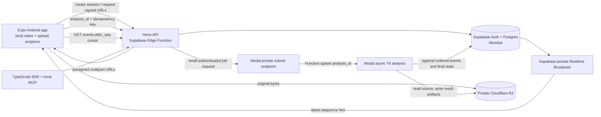

# Verdict

**Modify the stack and the upload path.** For the 24-hour build, use **Hono on Supabase Edge Functions, Supabase Auth/Postgres/Realtime in Mumbai, Cloudflare R2 for video and result artifacts, and Modal for asynchronous GPU analysis**. Keep one API and one durable event history. Let Modal’s asynchronous `Function.spawn()` handle job dispatch. Remove the separate Cloudflare Worker and Cloudflare Queue from the first build.

Upload the original video bytes directly to R2. Keep the video playing locally while upload progress is visible. Start cloud analysis after the multipart upload completes, then publish partial analysis events as results arrive. **Remove phone-side keyframe remuxing and rally-first upload ordering from the MVP.** The Android APIs can support remuxing, but the chosen phones’ gallery files and the full remux path have not been verified.

This stack preserves the important boundaries while dropping an API runtime and a second queue. Supabase has Auth, Postgres, Realtime, and Edge Functions; its current docs support Hono and custom route handling. R2 remains necessary for full match videos: Supabase Free storage has a 50 MB per-file limit. [Supabase Hono routing](https://supabase.com/docs/guides/functions/routing), [Supabase Free plan limits](https://supabase.com/docs/guides/platform/billing-on-supabase), [Supabase storage file limits](https://supabase.com/docs/guides/storage/uploads/file-limits)

I reviewed both draft docs and the named reports, plus the relevant product and vision docs. The D1 app-stack report was absent from the workspace during this review, so the recommendation assumes Expo stays. [Architecture draft](</Users/Hetansh/Github/elevate1.0/docs/03-architecture-and-streaming.md>), [developer-platform draft](</Users/Hetansh/Github/elevate1.0/docs/08-developer-platform.md>), [cloud-streaming research](</Users/Hetansh/Github/elevate1.0/research/out/16-cloud-streaming.md>), [API deployment research](</Users/Hetansh/Github/elevate1.0/research/out/03-api-platform-deploy.md>), [session-memory research](</Users/Hetansh/Github/elevate1.0/research/out/17-session-memory.md>), [device-capability research](</Users/Hetansh/Github/elevate1.0/research/out/18-device-capabilities.md>), [tooling research](</Users/Hetansh/Github/elevate1.0/research/out/06-team-tooling.md>).

## Decision verdicts

| Decision | Verdict | Replacement |
|---|---|---|
| Cloud API runtime | **MODIFY** | Put one Hono API in Supabase Edge Functions. Retain Supabase Auth, Mumbai Postgres, and Realtime. |
| Video storage | **KEEP, narrow its role** | Private R2 bucket for source video and result artifacts. Supabase stores metadata and event rows. |
| GPU job dispatch | **MODIFY** | Use Modal `Function.spawn()` as the async job queue. Do not add Cloudflare Queues in the MVP. |
| Phone-side remux and timed segments | **REPLACE** | Upload original bytes with resumable R2 multipart upload. Split into logical processing windows on the server after upload completion. |
| Rally-first ordering by audio | **REPLACE** | Start processing in source presentation-time order. Defer audio onset ordering until it has real match-clip evidence. |
| Realtime plus polling | **MODIFY** | Supabase Realtime Broadcast is a wake-up signal. A cursor-based REST endpoint is the durable event source. Remove the second SSE event contract. |
| Segment stitching | **MODIFY** | Process one analysis in order on one Modal job. Preserve global source timestamps and finalize once. |
| API/SDK/MCP scope | **MODIFY** | OpenAPI 3.0.4, generated TypeScript client, capability manifest, evidence links, then a read-only local MCP server if the core path works. Defer Python SDK, remote MCP, webhooks, and the embedded player. |
| Modal account and region | **MODIFY** | One Modal operator, one protected CI deployment token, one GPU worker maximum. Start with broad AP region and Mumbai routing for small control messages. |

## Claim audit

| Draft claim | Status | Evidence |
|---|---|---|
| 20 seconds at 20 Mbps is about 50 MB | **CONFIRMED as an assumption** | Arithmetic gives 400 Mbit, or 50 MB decimal. Actual camera bitrate and file size vary. |
| A 50 MB upload takes about 12 seconds at 34 to 37 Mbps | **CONFIRMED as ideal arithmetic; UNVERIFIED as a venue expectation** | Current Mumbai results vary materially. TRAI’s June 2026 city test reported mixed 4G/5G route averages of 25.92 Mbps for Airtel and 40.92 Mbps for Jio. Opensignal’s February 2026 Mumbai user averages were 8.9 and 11.0 Mbps. [TRAI report](https://trai.gov.in/sites/default/files/2026-09/IDT_Mumbai_20072026.pdf), [TRAI report index](https://trai.gov.in/release-publication/qos-reports/idt-reports), [Opensignal report](https://insights.opensignal.com/reports/2026/02/india/mobile-network-experience) |
| Modal T4 inference at 150 FPS | **UNVERIFIED** | No T4 benchmark for the selected end-to-end vision pipeline is present. The local M4 result is not a cloud result. The research reports also describe poor tracking on handheld badminton footage. [Vision-engine draft](</Users/Hetansh/Github/elevate1.0/docs/04-vision-engine.md>), [cloud-streaming research](</Users/Hetansh/Github/elevate1.0/research/out/16-cloud-streaming.md>) |
| First result in 10 to 15 seconds, full analysis in 25 to 40 seconds | **UNVERIFIED** | It depends on upload, model initialization, selected frames, and real T4 throughput. Modal says containers boot in about one second; imports and model loading can add seconds or minutes. [Modal cold starts](https://modal.com/docs/guide/cold-start) |
| Android can remux H.264 or HEVC MP4 without re-encoding | **CONFIRMED as API capability; UNVERIFIED for these handset files** | `MediaExtractor` exposes presentation timestamps and sync samples. `MediaMuxer` supports MP4 HEVC from API 24. Its orientation hint stores a playback matrix and does not rotate pixels; some players ignore the matrix. Track samples must be written chronologically. [MediaExtractor](https://developer.android.com/reference/android/media/MediaExtractor), [MediaMuxer](https://developer.android.com/reference/android/media/MediaMuxer) |
| Samsung gallery files are safe for 6-second remux segments | **UNVERIFIED** | The APIs do not prove compatibility with the S23 FE and A55 files covering moov placement, VFR, audio alignment, rotation, and the selected codecs. A custom Expo Kotlin module also requires a development build; Expo Go cannot load it. [Expo native code](https://docs.expo.dev/workflow/customizing/) |
| Supabase is suitable for canonical match history in Mumbai | **CONFIRMED with free-tier limits** | Supabase offers Mumbai `ap-south-1`. Free includes 500 MB database, 1 GB file storage, 50 MB maximum file upload, 5 GB egress, 500,000 Edge Function calls, 2 million Realtime messages, and 200 peak connections. Free projects can pause after seven days of low activity. Keep video and large result arrays out of Postgres. [Regions](https://supabase.com/docs/guides/platform/regions), [billing limits](https://supabase.com/docs/guides/platform/billing-on-supabase), [project pausing](https://supabase.com/docs/guides/platform/free-project-pausing) |
| R2 works for direct, resumable video uploads | **CONFIRMED** | R2 Free includes 10 GB-month storage, 1 million Class A requests, 10 million Class B requests, and free egress. Single PUT is not resumable; multipart retries failed parts, with 5 MiB minimum parts, up to 10,000 parts and 5 TiB per object. Direct presigned upload bypasses the API runtime. [R2 pricing](https://developers.cloudflare.com/r2/pricing/), [upload methods](https://developers.cloudflare.com/r2/objects/upload-objects/), [presigned URLs](https://developers.cloudflare.com/r2/api/s3/presigned-urls/) |
| Cloudflare Workers are suitable for the thin API | **CONFIRMED, but not the simplest choice here** | Free Workers allow 100,000 requests/day, 10 ms CPU per request, and 100 MB request bodies. They can issue upload URLs, but Supabase Edge Functions can host the Hono API alongside Auth and Postgres. [Workers limits](https://developers.cloudflare.com/workers/platform/limits/), [Supabase Hono routing](https://supabase.com/docs/guides/functions/routing) |
| Modal Starter fits the team and GPU plan | **CONFIRMED with a hard card/account gate** | Starter includes $30 monthly compute credits, three workspace seats, ten GPU concurrency, and a T4 at $0.000164/second. GPU use requires a valid payment method. Starter does not include service users, so CI deployment uses one human operator’s token. [Modal pricing](https://modal.com/pricing), [GPU requirements](https://modal.com/docs/guide/gpu), [service users](https://modal.com/docs/guide/service-users), [CI deployment](https://modal.com/docs/guide/continuous-deployment) |
| Modal region choice materially improves the live demo | **PARTLY CONFIRMED; end-to-end latency UNVERIFIED** | Modal’s default routing is `us-east`. Broad `ap` is 1.15x base price; narrow `ap-south` is 1.75x. Routing can be set to Mumbai for small requests, but payloads above 2 MiB still use object storage in `us-east`. Send an analysis ID and R2 object key, never video bytes. R2 `apac` is only a best-effort hint. [Modal region selection](https://modal.com/docs/guide/region-selection), [R2 data location](https://developers.cloudflare.com/r2/reference/data-location/) |
| OpenAPI 3.0.x and the proposed generated SDK are current | **MODIFY** | OpenAPI 3.2.1 is current, but OpenAPI Generator 7.26.0 documents 3.1 support as beta and does not establish 3.2 support. Use 3.0.4 for this build and generate only the TypeScript client. [OpenAPI 3.2.1](https://spec.openapis.org/oas/v3.2.1.html), [Generator 7.26.0](https://github.com/OpenAPITools/openapi-generator/releases), [generator compatibility](https://github.com/OpenAPITools/openapi-generator/) |
| MCP 2026-07-28 and current TypeScript SDK are settled | **SPEC CONFIRMED; judge-host compatibility UNVERIFIED** | The MCP TypeScript SDK 2.3.1 implements the 2026-07-28 spec. Its v2 wire behavior is recent. Test against the actual host available to the team before claiming interoperability. [SDK 2.3.1 release](https://github.com/modelcontextprotocol/typescript-sdk/releases), [v2 docs](https://ts.sdk.modelcontextprotocol.io/v2/), [spec release](https://blog.modelcontextprotocol.io/posts/2026-07-28/) |

## Recommended architecture and pipeline



### Upload and playback

Use Expo SDK 57 on Android. Expo SDK 57 includes React Native 0.86. Expo’s current npm `sdk-57` tag has `expo-image-picker` 57.0.19 and `expo-file-system` 57.0.7. FileSystem exposes `FileHandle.offset` and `readBytes()`, which can provide upload chunks. The R2 signing helper `aws4fetch` 1.0.20 is MIT licensed and uses `fetch` and `SubtleCrypto`; Supabase Edge Functions support Deno and npm packages. Compatibility across this exact runtime path is an inference from those sources, so make a presigned multipart upload the first integration probe. [Expo SDK 57](https://expo.dev/changelog/sdk-57), [ImagePicker package](https://www.npmjs.com/package/expo-image-picker), [FileSystem 57 docs](https://docs.expo.dev/versions/v57.0.0/sdk/filesystem/), [aws4fetch](https://www.npmjs.com/package/aws4fetch), [Supabase dependencies](https://supabase.com/docs/guides/functions/dependencies)

The app should:

1. Let the user select a video and start local playback immediately.
2. Request a private R2 multipart upload with a server-generated object key.
3. Upload original bytes directly to R2 in 8 MiB parts, with two concurrent parts as the starting setting. Persist `uploadId`, completed part numbers, and ETags on the device. Each R2 part must be at least 5 MiB except the last part.
4. Complete the multipart upload, then create one analysis run.
5. Show actual upload progress, current phase, and available earlier sessions while the original video remains playable.

Do not send video through Supabase Functions or Workers. Do not store video in Supabase Storage. The Deno signer and React Native chunk body still need a device and R2 fixture probe; **Samsung content-URI behavior and upload retry behavior are UNVERIFIED**.

For the hackathon, keep upload visible in the app. If you need reliable background uploads after the user leaves the screen, that becomes native Android work. WorkManager 2.11.2 is current stable; Android user-initiated data-transfer jobs require API 34 and a JobScheduler implementation with a notification. That native work is outside the smallest Expo path. [WorkManager releases](https://developer.android.com/jetpack/androidx/releases/work), [Android UIDT jobs](https://developer.android.com/develop/background-work/background-tasks/uidt)

### Server analysis, Modal, and region

Store the original upload in private R2. After completion, the Modal worker reads the video by object key and decodes it in ordered logical windows with a shared source timeline. Use FFmpeg 9.0.1 for server-side probing and decoding if that is the chosen container build. FFmpeg is LGPL 2.1+ by default; enabling GPL components changes the applicable license, so record the actual build options. [FFmpeg release](https://ffmpeg.org/download.html), [FFmpeg licensing](https://www.ffmpeg.org/legal.html)

Have the Hono Edge Function write the analysis row, then call a small authenticated Modal submission endpoint. That endpoint calls Modal `Function.spawn(analysis_id)` and returns the `FunctionCall` ID. Modal documents this as asynchronous, durable execution whose result remains available for seven days. Store the authoritative result and history in Supabase and R2; Modal’s result retention is only a job-recovery aid. This replaces a separate Cloudflare Queue, whose free tier has a 24-hour retention limit and at-least-once delivery. [Modal invocation methods](https://modal.com/docs/guide/function-invocation-methods), [Cloudflare Queue pricing](https://developers.cloudflare.com/queues/platform/pricing/), [Queue delivery guarantees](https://developers.cloudflare.com/queues/reference/delivery-guarantees/)

Use one Modal analysis job per `analysis_id`, not one job per video window. Set the job’s R2 and Supabase credentials as Modal secrets. Pass only the analysis ID and object key to the submission endpoint. Use an idempotency key and deterministic result keys so a retry can waste compute without duplicating history or final results.

Start with broad Modal region `ap` at 1.15x pricing. Use `routing_region="ap-south"` for the small submit request. Do not pay the 1.75x narrow `ap-south` container multiplier until an actual fetch benchmark shows the improvement. Supabase’s exact Mumbai region is confirmed; R2’s `apac` location hint is not a Mumbai placement guarantee. End-to-end India latency remains **UNVERIFIED**.

For one T4, one physical CPU core, and 4 GiB RAM, current listed Modal rates imply about **$0.77/hour in broad AP** or **$1.17/hour in narrow AP-South**. These are calculated estimates, before other usage. A five-minute warm window is about six cents broad AP or ten cents narrow AP. Modal model initialization time remains unmeasured. [Modal pricing](https://modal.com/pricing), [region multipliers](https://modal.com/docs/guide/region-selection), [cold starts](https://modal.com/docs/guide/cold-start)

### Timing budget

A 20-second clip encoded at an assumed 20 Mbps is about 50 MB. The following transfer times are ideal calculations, not app measurements:

| Network evidence | Average upload speed | Ideal time for 50 MB |
|---|---:|---:|
| TRAI Mumbai route, Jio mixed 5G/4G | 40.92 Mbps | 9.8 sec |
| TRAI Mumbai route, Airtel mixed 5G/4G | 25.92 Mbps | 15.4 sec |
| Opensignal Mumbai user average, Jio | 11.0 Mbps | 36.4 sec |
| Opensignal Mumbai user average, Airtel | 8.9 Mbps | 44.9 sec |

The two studies use different sampling methods. Neither predicts connectivity at the college venue. Their measured speeds and collection periods are described in the [TRAI June report](https://trai.gov.in/sites/default/files/2026-09/IDT_Mumbai_20072026.pdf) and [Opensignal February report](https://insights.opensignal.com/reports/2026/02/india/mobile-network-experience).

A five-minute recording at the same assumed 20 Mbps is 750 MB. Ideal upload time ranges from about **2.4 minutes at 40.92 Mbps to 11.2 minutes at 8.9 Mbps**, before protocol overhead or network variation. That is why the 20-second college clip is a useful live upload demonstration, but its upload time does not represent a full post-game match.

A 20-second, 60 FPS clip contains 1,200 frames. Processing all frames at 30, 60, or 120 frames per second would take 40, 20, or 10 seconds respectively. Those are arithmetic scenarios, not Modal measurements. No full pipeline speed is confirmed. **Replace the 25 to 40 second end-to-end promise and 10 to 15 second first-rally promise with “ETA based on current upload rate; analysis time depends on clip and server load.”** Reserve two to three minutes in rehearsal, warm the worker just before the pitch, and keep a clearly labeled prepared result available if the network fails.

### Event contract and final stitching

Make the event table in Supabase the source of truth. Assign `seq` inside a database transaction per analysis. Use timestamps for display; never use them to order events.

```json
{
  "event_id": "uuid",
  "match_id": "uuid",
  "analysis_id": "uuid",
  "seq": 13,
  "schema_version": 1,
  "type": "segment.completed",
  "segment_seq": 3,
  "source_time_start_us": 12000000,
  "source_time_end_us": 18000000,
  "artifact_id": "uuid",
  "capability_status": "partial",
  "confidence": null,
  "engine_version": "pipeline-version",
  "created_at": "2026-10-10T12:00:00Z"
}
```

Use these server states: `awaiting_upload`, `uploaded`, `queued`, `processing`, `partial`, `finalizing`, `completed`, `failed`, `cancelled`. Keep byte progress and `waiting_for_network` on the device; they are not server analysis events.

Emit `analysis.queued`, `analysis.started`, `segment.completed`, `analysis.partial`, `analysis.finalizing`, `analysis.completed`, and `analysis.failed`. Keep track arrays and frame detections in R2 artifacts. The event row carries an `artifact_id`; the API resolves it to a short-lived signed URL after checking ownership.

For live updates, broadcast `{schema_version, analysis_id, latest_seq}` to a private `analysis:{analysis_id}` Supabase Realtime channel. The client then calls:

```text
GET /v1/analyses/{analysis_id}
GET /v1/analyses/{analysis_id}/events?after_seq={last_seq}&limit=100
```

Return `{events, next_after_seq, has_more, state}`. Ignore duplicate sequences. If a sequence gap appears, fetch from the last contiguous sequence. Poll every two seconds while the analysis view is foregrounded, then back off when the app is idle. Realtime is a hint; the cursor endpoint is durable. Supabase supports Realtime Broadcast, while the client can recover missed events by querying Postgres through the API. [Broadcast docs](https://supabase.com/docs/guides/realtime/broadcast), [Realtime limits](https://supabase.com/docs/guides/realtime/limits)

For stitching, normalize every video time to microseconds relative to the first presented frame. Process ordered six-second logical windows with 0.5 to 1 second overlap. Keep one worker per analysis and carry tracking state across windows. Deduplicate detections by source time. If a player identity cannot be matched through the overlap, keep the IDs separate and mark continuity uncertain. Merge rallies only where their times and evidence agree. The finalizer checks that every window has a result or explicit failure, computes summaries, writes the final artifact, and emits exactly one `analysis.completed`.

### Strongest alternatives

| Alternative | Steelman | Verdict |
|---|---|---|
| Cloudflare Worker + Supabase + R2 + Modal | Strong Deno-free public API path in the Cloudflare account that already owns R2. Its limits are ample for a thin API. | **Valid fallback.** Keep it if Deno/SigV4 integration blocks the Supabase Edge Function path or a Worker custom domain matters. |
| Supabase Edge Functions + Auth/Postgres/Realtime + R2 + Modal | Fewer deployments. Current Supabase docs support Hono routes and NPM dependencies, with 500,000 free function calls per month. | **Recommended.** R2 remains necessary for match-sized videos; Supabase Storage caps files at 50 MB on Free. |
| Workers + D1 + R2 + Modal | One Cloudflare control plane and a simpler SQLite-style data path. | **REJECT for this MVP.** D1 Free has 500 MB per database, 5 million row reads/day and 100,000 writes/day; exceeding daily limits fails queries. Replacing Supabase also means building or sourcing Auth and Realtime behavior. [D1 limits](https://developers.cloudflare.com/d1/platform/limits/), [free-tier enforcement](https://developers.cloudflare.com/changelog/post/2026-09-01-d1-free-tier-limit-enforcement/) |
| FastAPI as the public API on Modal | One Python stack for API and computer vision; straightforward sharing of model code. | **REJECT as public API.** It couples player history, auth-facing APIs, and SDK traffic to Modal startup and GPU-account availability. Keep a small private FastAPI endpoint inside Modal only to submit jobs. |
| Cloudflare Queue before Modal | Separates API requests from processing, with a free quota adequate for a hackathon. | **DEFER.** Modal `Function.spawn()` already provides asynchronous job execution. Adding another queue adds duplicate-delivery handling and a second job-state path. |

## Skeptical review

**Senior engineer:** The draft runs three competing event paths: Supabase Realtime, an API SSE endpoint, and polling. It also gives the phone segmentation, the server segmentation, and the final stitcher overlapping ownership. The recommendations above create one API and one event cursor, and keep all source timestamps global.

**Hackathon judge:** The timing figures currently sound like measured service guarantees. They are not. Present the 50 FPS M4 result as a local, static tennis probe; do not use it as a T4 promise. The vision draft reports poor handheld badminton results and no detection on informal catch footage from the sport-specific detector. Treat the college clip as upload and evidence-UI proof. If you show motion tracking there, label it experimental and use tap-to-track where needed. [Vision-engine evidence](</Users/Hetansh/Github/elevate1.0/docs/04-vision-engine.md>), [PS fundamentals](</Users/Hetansh/Github/elevate1.0/docs/01-ps-fundamentals.md>)

**Player or coach:** A full match can take minutes to upload. The app must show the local video, bytes uploaded, retry state, and analysis stages. Keep prior sessions accessible while a new one processes. Persist `match_id`, `analysis_id`, model version, capability status, and artifact references so history does not depend on a currently running Modal call. [Session-memory research](</Users/Hetansh/Github/elevate1.0/research/out/17-session-memory.md>), [app-experience draft](</Users/Hetansh/Github/elevate1.0/docs/05-app-experience.md>)

**Developer judge:** An OpenAPI file and generated client are a stronger first artifact than four half-finished interfaces. Publish one TypeScript client and a sample that loads a match summary, pages through event cursors, and opens a clip by source timestamp. A read-only MCP server with `get_match_summary` and `find_moments` is a good extra once that flow works. Use MCP TypeScript SDK 2.3.1 with the 2026-07-28 spec; test it with one actual host before claiming compatibility. [OpenAPI Generator 7.26.0 release](https://github.com/OpenAPITools/openapi-generator/releases), [MCP SDK release](https://github.com/modelcontextprotocol/typescript-sdk/releases)

## Required edits

1. **Replace the main architecture section** with:

   > The Android app uses Expo SDK 57 and uploads the selected original video directly to a private Cloudflare R2 bucket using presigned multipart URLs. The app keeps the original video available for local playback while the upload runs. Supabase Auth, Edge Functions, Postgres in Mumbai, and Realtime own API requests, player and match history, analysis state, and ordered events. Modal runs one asynchronous GPU analysis per analysis ID and reads the source by R2 object key. Supabase Postgres is the canonical store; R2 stores source video and larger result artifacts.

2. **Replace client remux and rally-first steps** with:

   > The phone does not remux or time-segment video for the hackathon MVP. It uploads original bytes in resumable R2 multipart parts, saves part progress locally, and creates an analysis after multipart completion. The server decodes the completed source in presentation-time order and processes it in overlapping logical windows. New cloud analysis requires network access; cached history and local video remain available offline.

3. **Replace the job dispatch description** with:

   > `POST /v1/analyses` creates or returns one idempotent analysis record, then calls a private Modal submission endpoint with the analysis ID and R2 object key. The Modal endpoint calls `Function.spawn()` and returns its call ID. A duplicate submission may repeat compute, but output object keys, segment result rows, and final completion are idempotent on analysis ID and engine version.

4. **Replace the Realtime/SSE paragraph and draft schema** with the event contract above. Remove `GET .../events` as SSE. Keep REST cursor pagination as the public API and use private Supabase Broadcast only as a `latest_seq` notification.

5. **Replace the timing table** with the network table above. Mark the 150 FPS, first-rally, and total-analysis figures **UNVERIFIED** until measured on the exact Modal image, model files, phone footage, and venue network.

6. **Replace the developer-platform scope** with:

   > OpenAPI 3.0.4 is the source contract. Generate a TypeScript client with OpenAPI Generator 7.26.0. The first developer demo covers capabilities, creating an analysis, reading its state, paging events, and opening evidence by artifact ID. Defer the Python client, remote MCP authorization, webhooks, and embeddable player until this flow works. Add a local read-only MCP server with two tools only after a one-host compatibility check.

   Current relevant versions are: **Hono 4.13.13** (MIT), **`@hono/zod-openapi` 1.6.3** (MIT), **Expo SDK 57 / React Native 0.86.3**, **`expo-image-picker` 57.0.19** (MIT), **`expo-file-system` 57.0.7** (MIT), **`aws4fetch` 1.0.20** (MIT), **Modal Python SDK 1.6.0**, **FFmpeg 9.0.1** (LGPL 2.1+ by default), **OpenAPI Generator 7.26.0** (Apache-2.0), and **MCP TypeScript SDK 2.3.1**. Sources: [Hono 4.13.13 release](https://github.com/honojs/hono/releases), [`@hono/zod-openapi`](https://www.npmjs.com/package/%40hono/zod-openapi), [Expo SDK 57](https://expo.dev/changelog/sdk-57), [ImagePicker 57.0.19](https://www.npmjs.com/package/expo-image-picker), [FileSystem 57.0.7](https://www.npmjs.com/package/expo-file-system), [`aws4fetch` 1.0.20](https://www.npmjs.com/package/aws4fetch), [Modal 1.6.0](https://pypi.org/project/modal/), [FFmpeg 9.0.1](https://ffmpeg.org/download.html), [OpenAPI Generator](https://github.com/OpenAPITools/openapi-generator/releases), [MCP SDK 2.3.1](https://github.com/modelcontextprotocol/typescript-sdk/releases).

7. **Add a free-tier operations paragraph**: keep videos out of Postgres and Supabase Storage, set a per-upload size cap, restrict Modal to one GPU worker, and enforce R2 storage cleanup. Keep event arrays and model outputs as R2 artifacts. Supabase Free can pause after seven days of low activity, and Modal’s compute credit is not a lifetime free guarantee.

## Recommendation

Use Supabase Edge Functions as the Hono API, Supabase Auth/Postgres/Realtime in Mumbai, R2 for video and artifacts, and Modal `Function.spawn()` for analysis. Start with direct multipart upload, a playable local video, an honest phase timeline, cursor-based events, and one sequential analysis job. The first engineering probe should verify the complete R2 path: Expo file chunk, presigned multipart URL, object completion, and Modal read.

## 3 biggest risks

1. **Upload time:** a 50 MB demo clip can take roughly 10 to 45 seconds under published Mumbai averages, while a 750 MB match can take minutes.
2. **Analysis proof:** the T4 pipeline and end-to-end time are unmeasured; the supplied handheld badminton and informal-catch evidence is weak.
3. **Free service gates:** Modal requires a payment method for GPU use and Starter has only three seats; Supabase can pause after inactivity, and R2/Modal usage must stay inside free allowances.

## Open questions only the team can answer

1. Who owns the Modal operator account and is willing to add the required payment method?
2. Should the cloud retain full match videos across sessions, or keep durable statistics and only short evidence clips under a strict R2 quota?
3. Which exact phone, carrier, and clip will be used for the live upload demonstration?
4. Will the demo use guest sessions or require players to create accounts and share match history?
5. Which MCP host can the developer judge use at the venue, and will it have network access?