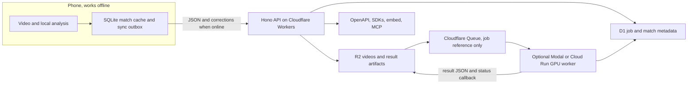

# Verdict

Build **an offline-first player app with a small deployed cloud control plane**, then make server inference an optional async worker. Put the phone upload path, API, job state, docs, and MCP interface in place early; keep the demo able to show a cached match with no internet. Treat free GPU capacity as a bonus, because none of the providers offers a dependable, unlimited free GPU service.

For cloud inference, **Modal Starter is the best first option to try**: it includes $30 of monthly compute credit and supports GPUs including T4, L4, and A10. **Cloud Run GPU is the stronger Google Cloud option if the team already has eligible trial credits and GPU quota**. Neither provider’s published data verifies India request latency or racket-sport video throughput. [Modal pricing](https://modal.com/pricing), [Cloud Run GPU configuration](https://docs.cloud.google.com/run/docs/configuring/jobs/gpu?hl=en)

I checked provider documentation and pricing on **2026-10-10**. India latency and end-to-end inference speed remain **UNVERIFIED**. No perception model or weight file was selected in this platform track, so its model filename and size are also **UNVERIFIED**.

## Architectures

| | A. On-device engine, thin cloud | B. Cloud inference engine |
|---|---|---|
| Analysis | Phone runs the engine and saves video and results locally. | Phone uploads video directly to object storage; a GPU worker analyzes it asynchronously. |
| Cloud role | Syncs match JSON, user corrections, API access, webhooks, and MCP. | Manages uploads and jobs, stores results, and serves API, webhooks, and MCP. |
| Offline behavior | Best: analysis and cached matches can work without a network, if the phone engine is ready. | Upload and new analysis need connectivity; cached matches can still be shown offline. |
| Main cost | Phone performance and battery. | GPU credits, upload time, and provider availability. |
| Evidence gap | Phone speed, thermals, and accuracy across sports are **UNVERIFIED**. | India latency, free GPU availability at demo time, and analysis throughput are **UNVERIFIED**. |

**Recommendation:** build the app and schema so both engines return the same result format. Use local analysis when it is available; submit a cloud job otherwise. That makes the cloud path useful without making connectivity a demo prerequisite.

## GPU and hosting options

Cold-start figures below describe infrastructure startup where providers document it, not total time to first result. Loading the app and model weights adds time. No listed provider publishes comparable India p50/p95 latency for this workload; **India latency is UNVERIFIED** except where a GPU region is explicitly documented.

| Rank | Provider and GPU | Free amount or access | Cold start and max job | Upload and India notes |
|---|---|---|---|---|
| 1 | **Modal Starter**, T4, L4, A10, and larger GPUs | $30/month compute credit. GPU rates include T4 $0.000164/sec and L4 $0.000222/sec. Usage beyond the credit is billable. | Provider docs describe roughly 1-second container startup; full image and model load time is **UNVERIFIED**. Function timeout up to 24 hours. HTTP web function request timeout is 150 seconds, so submit a job and poll/callback instead of waiting on an upload request. | Don’t send 100 MB–2 GB videos through the inference endpoint. Use R2 and give the worker a short-lived object URL. India latency **UNVERIFIED**. [Pricing](https://modal.com/pricing), [timeouts](https://modal.com/docs/guide/timeouts), [web request timeouts](https://modal.com/docs/guide/webhook-timeouts) |
| 2 | **Google Cloud Run GPU**, L4 24 GB or RTX PRO 6000 Blackwell 96 GB | No recurring free GPU tier. New Google Cloud customers may get $300 in trial credits. GPU access also depends on project quota and billing setup. | GPU becomes available about 5 seconds after the instance starts; full model loading is **UNVERIFIED**. GPU job task timeout is capped at 1 hour. | HTTP/1 requests are capped at 32 MiB, so upload directly to R2. Delhi (`asia-south2`) has a documented GPU region; measured India latency is **UNVERIFIED**. [GPU jobs](https://docs.cloud.google.com/run/docs/configuring/jobs/gpu), [task timeouts](https://docs.cloud.google.com/run/docs/configuring/task-timeout?hl=en), [quotas](https://docs.cloud.google.com/run/quotas), [Google Cloud free tier](https://cloud.google.com/free/docs/free-cloud-features) |
| 3 | **Lightning AI**, including T4, L4, L40S, and A100 | Pricing advertises up to 80 free GPU hours to start. Listed examples include 75 T4 hours and 31 L4 hours, using up to 30 free credits. One free active Studio restarts every 4 hours. Verify the actual account offer before relying on it. | Four-hour restart cycle. Hard per-job duration and cold-start time are **UNVERIFIED**. Better for a batch worker than a dependable public inference endpoint. | Use object URLs rather than a large direct upload; endpoint upload limit and India latency are **UNVERIFIED**. [Pricing](https://lightning.ai/pricing), [hosted apps](https://lightning.ai/docs/platform/build/host-web-apps) |
| 4 | **Hugging Face Spaces ZeroGPU**, shared NVIDIA RTX PRO 6000 Blackwell | Free accounts in good standing can host up to two Spaces under account eligibility rules. Free GPU use is 5 minutes/day; the published quota is higher for paid plans. Shared GPU and queue priority make this a demo or experiment option. | GPU calls have a short per-call allowance; a dependable long-job limit and cold start are **UNVERIFIED**. | Spaces are not a good 2 GB upload path; use R2. India latency **UNVERIFIED**. [ZeroGPU rules](https://huggingface.co/docs/hub/en/spaces-zerogpu), [plan details](https://huggingface.co/pro) |
| 5 | **Kaggle notebooks**, GPU varies by availability | Free GPU quota is limited and can change with availability. Kaggle documents a maximum 12-hour notebook session; GPU use is subject to weekly quota. | Batch/manual notebook, not a serving endpoint. Session ceiling: 12 hours. Startup and queue time **UNVERIFIED**. | Fetch a dataset or object URL from a notebook rather than relying on a serving upload endpoint. India latency is not applicable to a stable API and is **UNVERIFIED**. [Notebooks](https://www.kaggle.com/docs/notebooks), [GPU usage](https://www.kaggle.com/docs/efficient-gpu-usage) |
| 6 | **Google Colab free**, GPU type varies | No guaranteed GPU type or fixed free quota. Runtime availability and limits vary; free sessions can run for up to 12 hours. | Notebook only, not a serving endpoint. Availability, startup, and practical run length are **UNVERIFIED**. | Not an upload/API service. Use only as a manual batch fallback. [Colab FAQ](https://research.google.com/colaboratory/faq.html) |
| 7 | **Cloudflare Workers AI**, managed models, not arbitrary GPUs | 10,000 neurons/day on the free allocation. It does not host a custom racket-sport GPU model. Useful for auxiliary model calls, not the main tracking engine. | Provider-managed inference; custom job duration and cold start are model-specific and **UNVERIFIED**. | Free Workers have a 100 MB request-body limit. This does not replace R2 direct uploads. [Pricing](https://developers.cloudflare.com/workers-ai/platform/pricing/), [model catalog](https://developers.cloudflare.com/workers-ai/models/), [Worker limits](https://developers.cloudflare.com/workers/platform/limits/) |

### Other providers and credits

| Provider | Free status on 2026-10-10 | Use in this project |
|---|---|---|
| **Cloudflare Containers** | No free GPU tier; containers are CPU-based and require a paid Workers plan. | Not a perception GPU option. Workers and Queues remain useful for API and dispatch. [Pricing](https://developers.cloudflare.com/containers/platform/pricing/) |
| **Replicate** | Pay per use after any trial allowance. Published prices include T4 $0.81/hour and L40S $3.51/hour. Direct SDK input limit is 100 MB; larger inputs should use a URL, with exact end-to-end limits **UNVERIFIED**. | Try only if the account shows usable free credit. [Pricing](https://replicate.com/pricing), [input files](https://replicate.com/docs/topics/predictions/input-files) |
| **RunPod** | No recurring free GPU allowance; pay per second. A startup program exists, but selection and credits are not guaranteed. | Near-free only if the team already has a grant. [Pricing](https://www.runpod.io/pricing), [startup program](https://www.runpod.io/startup-program) |
| **fal** | Pay per use; grants are selective, not a general free tier. | Do not make the demo depend on a grant. [Pricing](https://fal.ai/pricing), [builder grant](https://fal.ai/builder-grant) |
| **Baseten, Beam** | No free GPU compute amount verified. | Exclude from a free-only core stack. [Baseten pricing](https://www.baseten.co/pricing/), [Beam pricing](https://www.beam.cloud/pricing) |
| **Koyeb, Render, Railway, Fly.io** | Free tiers are CPU-focused, with small or limited services; no free GPU inference tier verified. Railway’s current plan includes a small $1/month credit after its trial. | Potential API hosting alternatives, but Cloudflare has a better fit for the proposed API, storage, and queue combination. [Koyeb](https://www.koyeb.com/docs/faqs/pricing), [Render](https://render.com/docs/free), [Railway](https://docs.railway.com/pricing/plans), [Fly.io](https://fly.io/docs/about/pricing/) |
| **Student and cloud credits** | Google Cloud offers a $300 new-customer trial; Azure for Students advertises $100 for eligible students; AWS’s new-account free plan advertises up to $200 in credits. GitHub Student Developer Pack includes education offers, including Microsoft benefits. GPU quota and eligibility for this use are **UNVERIFIED**. | Check existing accounts and quotas first. Don’t treat promotional credits as recurring free hosting. [Google](https://cloud.google.com/pricing), [Azure for Students](https://azure.microsoft.com/en-us/free/students), [AWS free plans](https://docs.aws.amazon.com/awsaccountbilling/latest/aboutv2/free-tier-plans.html), [GitHub Pack](https://education.github.com/pack) |

## Uploads for 100 MB to 2 GB videos

**Use direct-to-R2 multipart upload.** The phone asks the API for an upload ID and short-lived, signed part URLs, then sends each part directly to R2. Save the upload ID and completed part ETags on-device so the app can retry failed parts after a network interruption. The API should receive only the completion request, not the video bytes.

R2’s free Standard tier includes 10 GB-month storage, 1 million Class A operations, 10 million Class B operations, and free internet egress. Multipart uploads support parts from 5 MiB to 5 GiB, up to 10,000 parts. A 16 MiB part size is a reasonable implementation choice: it produces about 7 parts for a 100 MB file and 128 for a 2 GB file. These counts are estimates, not provider limits. [R2 pricing](https://developers.cloudflare.com/r2/pricing/), [R2 uploads](https://developers.cloudflare.com/r2/objects/upload-objects/)

| Option | Free limit or behavior | Fit |
|---|---|---|
| **R2 multipart** | 10 GB-month free Standard storage; resumable by retrying parts. | Best fit for full-resolution uploads. |
| **Supabase Storage** | Free plan has 1 GB storage and a 50 MB max file size; TUS resumable uploads are supported. | Good for small artifacts, too small for the requested raw clips. [Limits](https://supabase.com/docs/guides/storage/file-limits), [resumable uploads](https://supabase.com/docs/guides/storage/uploads/resumable-uploads), [billing](https://supabase.com/docs/guides/platform/billing-on-supabase) |
| **Backblaze B2** | 10 GB free storage and free egress up to three times average stored data; multipart supports large files. | Viable alternative, but R2 is simpler alongside Workers and Queues. India latency is **UNVERIFIED**. [Pricing](https://www.backblaze.com/cloud-storage/transaction-pricing), [large files](https://www.backblaze.com/docs/cloud-storage-large-files) |
| **TUS** | Open resumable upload protocol, version 1.0.0. | Use if a client or backend needs the TUS interface. R2 multipart is simpler for direct-to-bucket upload. [TUS protocol](https://tus.io/protocols/resumable-upload) |

Do not proxy video through a Cloudflare Worker, API server, queue message, or database. Cloudflare Free Worker request bodies are capped at 100 MB, which is below most of the requested range. [Worker limits](https://developers.cloudflare.com/workers/platform/limits/)

If the phone can produce useful analysis locally, send JSON tracks and selected lightweight artifacts instead of video. Whether phone-side processing can meet speed and quality requirements is **UNVERIFIED**.

## Jobs, results, and webhooks

**Recommended free control plane:** Hono on Cloudflare Workers, D1 for job and match metadata, R2 for video and larger result artifacts, and Cloudflare Queues for short job references. Workers Free allows 100,000 requests/day. Queues Free allows 10,000 operations/day with 24-hour retention; a consumed message usually takes three operations, so that is roughly 3,333 simple job messages/day before retries. Keep queue messages below 64 KB for predictable accounting, and never put video or full tracking arrays in them. [Worker limits](https://developers.cloudflare.com/workers/platform/limits/), [Queues pricing](https://developers.cloudflare.com/queues/platform/pricing/)

D1 Free includes 5 million rows read/day, 100,000 rows written/day, and 5 GB total storage. Use it for match summaries, jobs, ownership, API keys, and webhook delivery status, not as a blob store. [D1 pricing](https://developers.cloudflare.com/d1/platform/pricing/)

Suggested job lifecycle:

1. `POST /v1/uploads` creates the match ID and returns R2 multipart instructions.
2. Phone uploads parts, then finalizes the object.
3. API records an `analysis` row and enqueues a message containing only the match ID and object key.
4. A dispatcher starts a Modal or Cloud Run job.
5. Worker reads the private object, writes results to R2, then posts a signed status callback.
6. API updates D1 and delivers webhooks from a durable outbox.

Queue retention is only 24 hours on Free, so persist job state and webhook retries outside the queue. Webhook design should include unique event IDs, HMAC signatures over a timestamp and raw body, idempotent receiving, and retry state. These are proposed design choices, not provider defaults.

| Data option | Current free allowance | Recommendation |
|---|---|---|
| **D1 + R2 + Queues** | D1 5 GB and daily read/write caps; R2 10 GB-month; Queues 10,000 operations/day and 24-hour retention. | Simplest all-in-one hackathon stack if the team accepts SQLite-style metadata storage. |
| **Supabase Postgres + Storage + Queues** | Free Postgres and storage quotas are limited; Storage has a 50 MB max file. Free projects may pause after a week of inactivity. | Use Postgres if already familiar, but keep large videos in R2. [Free plan](https://supabase.com/docs/guides/platform/billing-on-supabase), [pausing](https://supabase.com/docs/guides/platform/free-project-pausing) |
| **Neon Postgres** | Free compute and storage quotas apply per project; exact limits can change. | Viable Postgres alternative, but adds another provider and regional latency is **UNVERIFIED**. [Plans](https://neon.com/docs/introduction/plans) |
| **Turso** | Free tier advertises 5 GB storage, 500 million row reads/month, 10 million writes/month, and 3 GB monthly sync. | Not needed for the first version. Embedded replica conflict behavior and fit for the chosen mobile stack are **UNVERIFIED**. [Pricing](https://turso.tech/pricing) |
| **PowerSync** | Free plan advertises 500 MB hosted storage and 2 GB synced/month. It is oriented around Postgres synchronization. | Consider only if choosing Postgres; it does not replace the D1-based custom outbox. [Pricing](https://powersync.com/pricing) |
| **Zero, Replicache** | Zero’s managed Hobby tier is paid and its docs describe offline-write limitations; Replicache’s GitHub repository is archived. | Do not choose for this hackathon. [Zero guidance](https://zero.rocicorp.dev/docs/when-to-use), [Replicache archive](https://github.com/rocicorp/replicache) |

## REST API, schema, and SDKs

Use one public API namespace, `/v1`, and one canonical OpenAPI description. The OpenAPI specification’s current published version is **3.2.1**. The selected SDK tooling’s compatibility with 3.2.1 is **UNVERIFIED**, so I would start with OpenAPI **3.1.2** until generation is verified. [OpenAPI version list](https://spec.openapis.org/oas/)

Recommended endpoints:

- `GET /v1/capabilities`
- `POST /v1/matches` and `GET /v1/matches/{match_id}`
- `POST /v1/uploads` and `POST /v1/uploads/{id}/complete`
- `POST /v1/analyses` returns `202 Accepted`
- `GET /v1/analyses/{analysis_id}`
- `GET /v1/matches/{match_id}/rallies`, `/shots`, and `/tracks`
- `POST /v1/webhook-endpoints` and `DELETE /v1/webhook-endpoints/{id}`

Each match result should include:

- Sport, ruleset version, participants, court setup, and coordinate convention.
- Source video hash, duration, frame rate, and provenance.
- Engine and model versions, device or server execution, and analysis timestamp.
- Score events, rallies, shots, bounces, and tracks with frame ranges and confidence.
- Capability tier per sport: `available`, `partial`, `experimental`, or `unsupported`.
- Provenance per value: `measured`, `inferred`, or `user`.
- Explicit `unknown`, `not_attempted`, and `unsupported` states, so missing detections are not presented as confirmed absence.

Keep inferred analysis immutable and store user corrections separately with device ID and revision. Use `Idempotency-Key` for create/finalize calls and `ETag`/`If-Match` when editing shared metadata. These are proposed API choices.

| Tool | Current version or status | Role |
|---|---|---|
| **Hono** | `4.13.13`, MIT | REST/API and webhook routes on Workers. [Package](https://www.npmjs.com/package/hono), [license](https://github.com/honojs/hono/blob/main/LICENSE) |
| **@hono/zod-openapi** | `1.6.3` | Define validated routes and emit OpenAPI from Zod schemas. [Package](https://www.npmjs.com/package/@hono/zod-openapi), [Hono example](https://hono.dev/examples/zod-openapi) |
| **OpenAPI Generator** | `7.26.0`, Apache-2.0 | Generate TypeScript and Python clients from the same spec. [Release](https://github.com/OpenAPITools/openapi-generator/releases/tag/v7.26.0), [TypeScript generator](https://openapi-generator.tech/docs/generators/typescript/), [Python generator](https://openapi-generator.tech/docs/generators/python/) |
| **FastAPI + Pydantic** | Latest package versions **UNVERIFIED** in this report | Strong option if the Python worker itself must host the public REST API. For the proposed Workers control plane, use Hono and keep the Python worker behind the job interface. |
| **tRPC** | Not selected | Useful in a TypeScript-only app, but not the canonical public contract for Python clients and OpenAPI. |

For the TypeScript SDK, use OpenAPI Generator’s `typescript-fetch` target; use its `python` target for Python. Keep the generated output derived from the schema, not hand-edited. For documentation, self-host Scalar’s API reference and include a seeded match with runnable curl examples. [Scalar](https://scalar.com/solutions/openapi-documentation)

For the first embed, build a read-only iframe at `/embed/matches/{match_id}` with a short-lived signed token. Add a React wrapper or `<racket-match-player>` custom element if time allows. Never put a developer API key in browser code. The embed can show synchronized replay, score and rally timeline, paths, shot markers, and confidence/provenance details.

## MCP and offline demonstration

The current MCP specification is dated **2026-07-28**. Its Streamable HTTP transport is stateless and uses POST requests; the revision removes protocol-level sessions. Because this is a recent change, compatibility across the exact SDKs and judge clients you use is **UNVERIFIED**. Build the server against a documented current handler and check client interoperability early. [Current specification](https://modelcontextprotocol.io/specification/2026-07-28), [revision notes](https://blog.modelcontextprotocol.io/posts/2026-07-28/)

For protected remote match data, follow MCP’s OAuth-based authorization requirements. Do not expose a shared developer key as a public connector credential. A local `stdio` server is appropriate for a laptop demo. [MCP authorization](https://modelcontextprotocol.io/specification/2026-07-28/basic/authorization), [stdio transport](https://modelcontextprotocol.io/specification/2026-07-28/basic/transports/stdio)

Start with read-only tools:

- `list_matches`
- `get_match_summary`
- `get_rally`
- `compare_players`
- `get_capabilities`
- `open_replay`

Return short summaries rather than the full tracking arrays. MCP Apps can add an interactive replay UI, but host support varies, so provide a text/JSON response and standalone iframe as fallbacks. [MCP Apps](https://apps.extensions.modelcontextprotocol.io/)

**Offline demo:** bundle a permissively licensed public clip and its clearly labeled precomputed result on the phone or laptop. Run a local stdio MCP server over that fixture. Claude Desktop supports local MCP servers, but its cloud model still needs internet. ChatGPT connects to remote MCP servers and does not directly connect to a local server; full MCP support is currently limited to Business and Enterprise/Edu plans, with Pro more limited. [Claude Desktop local MCP](https://support.anthropic.com/en/articles/10949351-getting-started-with-local-mcp-servers-on-claude-desktop), [ChatGPT MCP availability](https://help.openai.com/en/articles/12584461-developer-mode-and-full-mcp-connectors-in-chatgpt)

For a truly offline assistant, a local model client such as LM Studio documents MCP configuration and local model use. Whether a chosen local model can reliably call these tools on the demo laptop is **UNVERIFIED** and should be rehearsed. [LM Studio MCP](https://lmstudio.ai/docs/app/mcp), [local agents](https://lmstudio.ai/docs/developer)

## Offline-first sync

For a phone app, keep local match records and an outbox in SQLite. If the mobile app uses Expo, `expo-sqlite` is a concrete option. Sync JSON summaries and user corrections when online; do not sync raw video by default. [Expo SQLite](https://docs.expo.dev/versions/latest/sdk/sqlite/), [Expo local-first guide](https://docs.expo.dev/guides/local-first/)

Use immutable `analysis_id` results plus append-only correction records. On sync, merge non-conflicting metadata and corrections; if two devices change the same score or label, return a conflict for the user to resolve rather than silently overwriting analysis. Make replayed writes idempotent.

PowerSync is worth considering only if the backend uses supported Postgres. With D1, a small custom outbox is simpler for the hackathon and avoids adding a sync vendor. PouchDB/CouchDB offers offline document replication, but adds another storage model and server to operate. [PouchDB](https://pouchdb.apache.org/learn.html), [CouchDB replication](https://docs.couchdb.org/en/stable/replication/protocol.html)

## Developer-facing “wow”

The first developer experience should take under a minute:

1. Click **Create demo key**, scoped to seeded read-only data.
2. Open the match in interactive API docs and run a live curl example.
3. Run one TypeScript command and one Python command against the same demo match.
4. Embed the replay with overlays in an iframe.
5. Ask an MCP client for a match summary or a specific rally.

For the event, keep the clip and result cached locally so this sequence does not depend on QR scanning, venue internet, or GPU cold starts.

## Hour 0 to 3 deploy-first checklist

**Hour 0–1**

- Deploy a Worker with `GET /health`, `/openapi.json`, and `GET /v1/matches/demo`.
- Create D1 and seed one clearly labeled demo match.
- Serve Scalar docs and generate the TypeScript and Python clients.
- Check whether any team account has usable Modal or Google GPU credits and quota. Set spend controls before submitting GPU work.

**Hour 1–2**

- Create a private R2 bucket and multipart signing route.
- Implement an upload resume record on the phone: object key, upload ID, completed part ETags.
- Add a Queue and D1 job state, with a stub worker that completes a job without inference.
- Add the durable webhook outbox.

**Hour 2–3**

- Connect one actual worker only if its free allowance and quota are confirmed. First pass a tiny smoke job, then read the video from R2 and write a result artifact.
- Add the remote read-only MCP route and a local stdio server against the seeded fixture.
- Rehearse the phone’s cached replay and local MCP demo without internet.
- Do not make a first-time multi-gigabyte upload or model download part of the live pitch.

# Recommendation

Use **Cloudflare Workers + Hono + `@hono/zod-openapi` + D1 + R2 + Queues**, with **OpenAPI Generator 7.26.0** for TypeScript and Python SDKs. Keep match data local on the phone and sync JSON through a custom outbox. Treat Modal Starter as the first optional GPU worker, and Cloud Run GPU as the alternate if the team confirms credits, quota, and region access. Keep a public, permissively licensed clip and precomputed result available offline.

# Three biggest risks

1. **Free GPU availability and cost:** credits, quotas, account requirements, model startup, and cold starts can change the demo path. India throughput is **UNVERIFIED**.
2. **Perception accuracy:** the platform architecture cannot establish reliable tracking, scoring, or generalization across sports. The model files, sizes, and phone/server performance remain **UNVERIFIED** in this track.
3. **Upload and venue connectivity:** 100 MB–2 GB uploads can dominate the user experience on unreliable venue internet. The demo should use cached results and reserve uploads for rehearsed conditions.

# Open questions only the team can answer

- Which sport and public, permissively licensed clip will anchor the first complete analysis?
- Which phone framework and minimum device will the app target?
- Does anyone on the team already have verified access to a GPU provider account, free credit, and quota?
- Will the live developer demo use a local model client, or does the team have access to the required Claude or ChatGPT plan?