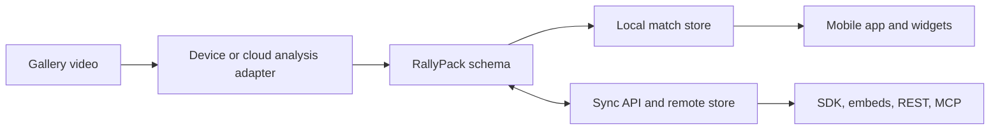

# Verdict

Build the daily loop around **one useful next action**, then make **RallyPack** the same source of match data for the app, SDK, API, embeds, coach sharing, and MCP. Use the phone gallery first, keep video local by default, and use widgets and local reminders to bring players back. Start social with a player’s existing partner or coach, not a public marketplace.

**Fully offline, cross-sport post-game analysis is UNVERIFIED.** This track found no same-device benchmarks for the selected sports, videos, or target phones. Design for offline import, playback, match history, corrections, and local reminders. Treat model speed, model size, licence, and on-device accuracy as **UNVERIFIED** until a separate test establishes them.

Labels below distinguish **verified** platform and pricing facts from **estimates** for product priorities and effort.

## 1. Daily-use product

### A day in the loop

| Moment | Player experience |
|---|---|
| Morning | A home-screen card shows one next step: the time of the next booked session, a coach-assigned drill, or a two-minute drill linked to a recurring weakness. If there is no useful cue, the card says “Rest day” or offers a saved moment to review. |
| Before a session | If the player opted in to calendar access, show the next court booking and a reminder at their chosen time. An outdoor forecast is optional and only appears for an outdoor court the player selected. |
| At the court | Arrival reminders are optional. Ask for background location only if the player turns on “Remind me when I arrive at this court.” |
| During the match | The user starts the score session. A Live Activity or Android live update shows the score only while that session is active. |
| After the match | The player chooses a video from the gallery. If the device can analyse it, the app works locally. If the selected engine needs connectivity, save the match and say that analysis is waiting. |
| Evening review | Show the score, a few evidence-backed moments, and one next action. The player can replay a rally, correct an event, or save a moment for later review. |
| Between sessions | Revisit a saved moment as a “Read the Shot” prompt, or practise one short drill linked to a match. The player can snooze, dismiss, or mark rest. |

The cadence is a **product estimate**: at most one non-urgent reminder per day, with quiet hours, snooze, and no reminder after dismissal for that cue. Combine three unreviewed matches into one prompt instead of sending three notifications. Count a weekly practice rhythm and preserve rest days. A missed day should not erase progress.

A drill should explain its source: “Try recovering to centre after this wide shot,” with a link to the supporting rally. Only create a personalised drill when enough evidence supports it. If there is not enough evidence, offer a general drill or no drill.

### First 60 seconds

1. Open to a useful empty state with two options: **Choose a video** or **Explore an example match**. Label the example as sample data.
2. Use the system picker. Do not require an account, camera, contacts, location, health access, or notifications to begin.
3. On iOS, Expo SDK 57’s default original-video path can trigger a Photos permission prompt **after** the user selects a video. Explain this just before opening the picker so it is not a surprise. [Expo ImagePicker documentation](https://docs.expo.dev/versions/v57.0.0/sdk/imagepicker/)
4. If the sport is unclear, ask the player to choose it. That is configuration, not training. Make court calibration optional.
5. Show progress and teach the result through an example while analysis runs. **A complete result within 60 seconds is UNVERIFIED.**

For a venue demo, preload a public clip whose licence allows the intended use, together with its RallyPack. If the analysis is precomputed, label it as example output. Do not present it as live inference.

### Ranked integrations

Effort is an **estimate for this team**, including native work and device verification.

| Rank | Integration | Value / effort | Current support and product use |
|---:|---|---|---|
| 1 | Home-screen “Today” widget | High / medium | WidgetKit on iOS; Android home widgets via Jetpack Glance. Use it for one stable cue, not live match data. Glance periodic updates are limited, so refresh when the app is used or when match state changes. [WidgetKit](https://developer.apple.com/documentation/widgetkit), [Glance update guidance](https://developer.android.com/develop/ui/compose/glance/glance-app-widget) |
| 2 | Local reminders | High / low | Schedule offline reminders for a chosen practice time or saved moment. Expo `expo-notifications ~57.0.22` supports scheduled local notifications. [Expo Notifications](https://docs.expo.dev/versions/v57.0.0/sdk/notifications/) |
| 3 | Next-session calendar cue | High / medium | Expo `expo-calendar ~57.0.5` reads system calendar events on iOS and Android. Ask for access only when the player enables it. The package requires a development build. [Expo Calendar](https://docs.expo.dev/versions/v57.0.0/sdk/calendar/) |
| 4 | Pair-first sharing and challenge | High / medium | Share a match card or selected rally through the system share sheet. Online invites can deep-link into the exact match. Nearby transfer can use AirDrop or supported Quick Share-to-AirDrop devices, with file import as fallback. Compatibility varies by device. [Expo Sharing](https://docs.expo.dev/versions/v57.0.0/sdk/sharing/), [Expo Linking](https://docs.expo.dev/versions/v57.0.0/sdk/linking/), [Google Quick Share support](https://support.google.com/pixelphone/answer/9286773?hl=en-uk) |
| 5 | Coach digest and drill assignment | High / medium-high | The coach sees a few shared moments, comments on a rally and assigns one drill. Practice completion can be stored offline and synced later. This is a product feature, not an OS integration. |
| 6 | iOS Live Activities and Android live updates | Medium-high / medium-high | Use only for a player-started score session or visible, user-started processing. iOS supports Live Activities through ActivityKit. Android 16 adds progress-centric notifications for user-initiated, start-to-end activity. [ActivityKit](https://developer.apple.com/documentation/activitykit), [Android 16 progress notifications](https://developer.android.com/about/versions/16/features/progress-centric-notifications) |
| 7 | Siri, Shortcuts, Control Center, Quick Settings | Medium / high | Good shortcuts are “Start scoring” and “Review last match.” Apple uses App Intents for widgets, controls, and Live Activities. Android Quick Settings tiles require a native `TileService` and the user must add the tile. [Apple App Intents](https://developer.apple.com/documentation/appintents/widgets-live-activities-and-controls), [Android Quick Settings tiles](https://developer.android.com/develop/ui/views/quicksettings-tiles) |
| 8 | HealthKit / Health Connect | Medium / high | Let the player connect a watch after the first useful result. If a watch recorded a workout and access is granted, align heart-rate samples to the match time. Add a manual sync point if video and workout clocks differ. Treat this as context, not proof that a rally caused a heart-rate change. [HealthKit access](https://developer.apple.com/documentation/healthkit/authorizing-access-to-health-data), [Health Connect workouts](https://developer.android.com/health-and-fitness/health-connect/experiences/workouts) |
| 9 | Outdoor weather | Low-medium / medium | Useful only for a saved outdoor venue. Apple WeatherKit includes 500,000 calls per month with Apple Developer Program membership, which costs $99/year. Open-Meteo’s free endpoint is non-commercial, limited to 10,000 calls/day, and has no uptime guarantee. It does not meet a strict free commercial-product requirement. [WeatherKit pricing](https://developer.apple.com/weatherkit/), [Apple Developer Program](https://developer.apple.com/programs/), [Open-Meteo pricing](https://open-meteo.com/en/pricing) |
| 10 | Arrival geofence | Low-medium / high | Offer only as an explicit opt-in. Expo `expo-location ~57.0.20` requires background permissions; iOS allows up to 20 monitored regions, Android up to 100. Expo documents different behavior when apps are terminated, including Android vendor variation. [Expo Location](https://docs.expo.dev/versions/v57.0.0/sdk/location/) |
| 11 | Apple Watch / Wear OS app and complications | Medium / very high | Useful later for score or practice cues. Apple supports complications through WidgetKit. I found no first-party Expo SDK 57 API for a Watch app target or Wear OS complications. Treat the RN integration path as **UNVERIFIED**; budget native targets. [Apple WidgetKit](https://developer.apple.com/documentation/widgetkit), [Wear OS UI](https://developer.android.com/training/wearables/user-interfaces) |

### iOS 26, Android 16, and Expo

As of **10 October 2026**, Expo SDK 57 is the current stable choice: React Native 0.86, minimum iOS 16.4, and Android compile/target API 36. Expo SDK 58 remains beta, uses React Native 0.88 RC, and adds Android widgets to `expo-widgets`; use it only if the team accepts beta risk for the widget path. [Expo SDK reference](https://docs.expo.dev/versions/latest/), [SDK 57 release](https://expo.dev/changelog/sdk-57), [SDK 58 beta](https://expo.dev/changelog/sdk-58-beta)

| SDK 57 package | Recommended version | Fit |
|---|---:|---|
| `expo-widgets` | `~57.0.23` | iOS home and Lock Screen widgets, interactive widgets, and Live Activities. Requires a development build; widget code runs in an isolated runtime and receives data through props. [Docs](https://docs.expo.dev/versions/v57.0.0/sdk/widgets/) |
| `expo-notifications` | `~57.0.22` | Local scheduled reminders; Android remote push requires a development build. [Docs](https://docs.expo.dev/versions/v57.0.0/sdk/notifications/) |
| `expo-calendar` | `~57.0.5` | Calendar access; requires a development build. [Docs](https://docs.expo.dev/versions/v57.0.0/sdk/calendar/) |
| `expo-image-picker` | `~57.0.20` | Gallery selection; explain iOS’s selected-video permission prompt before opening the picker. [Docs](https://docs.expo.dev/versions/v57.0.0/sdk/imagepicker/) |
| `expo-location` | `~57.0.20` | Optional foreground and geofence features; background access needs additional permission. [Docs](https://docs.expo.dev/versions/v57.0.0/sdk/location/) |
| `expo-document-picker` | `~57.0.3` | Import `.rally` files through the system file picker. [Docs](https://docs.expo.dev/versions/v57.0.0/sdk/document-picker/) |
| `expo-sharing` | `~57.0.22` | Share a selected file or match card through other apps. [Docs](https://docs.expo.dev/versions/v57.0.0/sdk/sharing/) |
| `expo-linking` | `~57.0.12` | Open a match or rally at a specific route. [Docs](https://docs.expo.dev/versions/v57.0.0/sdk/linking/) |

Native WidgetKit supports Lock Screen widgets, interactive widgets, Live Activities, Control Center controls, and watch complications. StandBy can display widgets or Live Activities while the iPhone is charging sideways. [Apple WidgetKit](https://developer.apple.com/documentation/widgetkit), [StandBy](https://support.apple.com/en-mt/guide/iphone/iph878d77632/ios)

Android supports home-screen widgets through Glance. Its Android 16 compatibility requirements make Lock Screen widgets optional, so do not depend on them across Android phones. [Android compatibility definition](https://source.android.google.cn/docs/compatibility/16/android-16-cdd?hl=en), [Jetpack Glance](https://developer.android.com/develop/ui/compose/glance)

For SDK 57, use Kotlin Glance for a stable Android widget. Use native Swift for iOS Control Center controls and App Intents that are not covered by the stable Expo package. `expo-app-intents ~0.5.4` is available in SDK 58 but is alpha. I found no first-party Expo SDK 57 health, Apple Watch app, Wear OS complication, or Android Quick Settings tile API; treat third-party package choices as **UNVERIFIED** and use native modules if these become priorities. [Expo App Intents](https://docs.expo.dev/versions/v58.0.0/sdk/app-intents/), [React Native native modules](https://reactnative.dev/docs/turbo-native-modules-introduction)

Android lock-screen updates are not a substitute for a widget. Android 16 Live Updates use progress-centric notifications for an ongoing, user-initiated activity. They fit an active score or analysis job, not a reminder about a future practice. [Android Live Updates](https://developer.android.com/develop/ui/views/notifications/live-update)

### Small social loop for a small network

Make the first social unit a **known pair**:

- Share a match card with score, sport, and one player-approved moment.
- Send a “Read the Shot” challenge with a chosen rally. Each player records a prediction, then the clip reveals the answer.
- Invite a partner to a session with a calendar event.
- Let a small club compare an opt-in metric after a match.

Do not require a public directory, global leaderboard, or a large user base. Offline, export a `.rally` challenge and response file. Online, send a link that opens the same rally in the app. AirDrop works for nearby Apple devices, and Quick Share-to-AirDrop is now supported on selected Android devices, but device support is not universal. Keep file import available. [Apple AirDrop](https://support.apple.com/en-gb/119857), [Google Quick Share compatibility](https://support.google.com/pixelphone/answer/9286773?hl=en-uk)

### Coach loop

The coach sees only matches the player shares. A digest contains a few linked moments, one evidence-backed pattern, and a drill. The coach comments on a rally or assigns a practice task. The player marks it practised after the session; this record syncs when the phone is online.

Do not send a coach a push for every uploaded match. Batch the digest or let the coach open it in their workflow. Let the player revoke access and choose whether a share includes the source video or only match data.

## Retention benchmarks

User complaints below are **anecdotal**, not a measure of what most users think. They are useful failure examples, not prevalence claims.

| App | What to borrow | Friction to avoid |
|---|---|---|
| Duolingo | One small action can maintain a routine. Friend Streaks create accountability with an existing friend. [Streak design](https://blog.duolingo.com/how-duolingo-streak-builds-habit/), [Friend Streak](https://blog.duolingo.com/friend-streak/) | Duolingo itself says losing a streak can feel demotivating. Use a weekly rhythm and optional partner challenges, not a punish-on-miss streak. [Duolingo’s streak discussion](https://blog.duolingo.com/how-duolingo-streak-builds-habit/); users also report guilt-toned reminders. [Example](https://www.reddit.com/r/duolingo/comments/1qkx0p6/notifications_like_this_are_the_worst/) |
| Strava | Activity history, clubs, events, and friend challenges create reasons to return and meet. [Features](https://www.strava.com/), [clubs and challenges](https://support.strava.com/en-us/collections/19657598-clubs-challenges-and-community) | Strava documents GPS drift and missing data. Indoor court tracking needs confidence and correction controls; avoid GPS-style rankings for unreliable signals. [Bad GPS data](https://support.strava.com/en-us/articles/15402181-bad-gps-data) |
| WHOOP | A short daily journal can connect behavior to longer-term trends. WHOOP describes its behavior insights as correlations, not causation. [Recovery insights](https://support.whoop.com/s/article/Recovery-Insights) | A 2026 reviewer described data overload and worry over a low score. Show one useful action, explain its evidence, and let the player’s own note override it. [Review](https://www.marieclaire.co.uk/health-fitness/fitness/whoop-meridian-review) |
| Oura | A readiness summary can make a complex history easy to scan. [Readiness score](https://support.ouraring.com/hc/en-us/articles/360025589793-Readiness-Score) | Users report that readiness can disagree with how they feel. Ask for a short subjective check-in before presenting a recommendation. [Example discussion](https://www.reddit.com/r/ouraring/comments/1rja6cf/after_a_year_of_oura_data_the_readiness_score_is/) |
| Apple Fitness | Rings, trends, awards, and history make progress visible. [Fitness summary](https://support.apple.com/en-ie/guide/iphone/iph4c34a8a95/ios) | Users describe pressure and guilt from daily rings. Do not make daily completion the product’s success measure. [2026 reporting](https://www.techradar.com/health-fitness/smartwatches/my-apple-watch-is-going-to-hate-this-our-wearables-are-making-us-anxious-and-obsessive-heres-how-we-can-all-do-about-it) |
| Headspace | Short daily practices and a chosen reminder can fit into an existing routine. [Daily meditation](https://www.headspace.com/meditation/daily-meditation) | A small feasibility study found that some participants found prompts increasingly annoying; users also report reminder frequency problems. Let users set timing and turn off promotional reminders. [Study](https://pmc.ncbi.nlm.nih.gov/articles/PMC8981020/), [user report](https://www.reddit.com/r/Headspace/comments/1jauy90) |
| Gentler Streak | A path that includes rest and recovery gives a useful alternative to “always do more.” [Activity Path](https://docs.gentler.app/understanding-your-activity-path/interpret-the-activity-path) | One App Store reviewer found the information scattered. Keep the match’s next action visible, and make deeper stats optional. [Review page](https://apps.apple.com/us/app/gentler-streak-workout-tracker/id1576857102?platform=ipad&see-all=reviews) |
| Speak | Lessons derived from a learner’s recent mistakes make practice personal. [Made For You lessons](https://help.speak.com/en/articles/11565779-what-are-made-for-you-custom-lessons) | A reliable, current sample of user complaints was **UNVERIFIED** in this scan. |
| Ladder | A coach-designed daily plan removes the “what should I do?” decision. [Product](https://www.joinladder.com/) | Some users report too many program choices and choice paralysis; others value the range. Put one recommended drill or assignment first. [Mixed user discussion](https://www.reddit.com/r/ladderapp/comments/1u9a10r/new_to_ladder_does_the_app_feel_overwhelming_at/) |
| Hevy | History and direct workout sharing help a coach or partner who does not use the same app. [Sharing and routines](https://help.hevyapp.com/hc/en-us/articles/34953501503895-How-to-Share-Workouts-and-Routines-in-Hevy) | Some coaches report difficulty retaining access to inactive client histories. Make the match export portable and avoid tying history to a coach subscription. [Example](https://www.reddit.com/r/Hevy/comments/1uuvltl/hevy_coach_requires_paying_for_inactive_clients/) |

## 2. One system for app, API, SDK, embeds, and MCP

### Proposed portable format: `RallyPack`

`RallyPack` is a **proposed format**, not an existing standard. Use `.rally` as a ZIP archive containing:

- `manifest.json`: format version, pack ID, hashes, scope, and media availability.
- `match.json`: stable match, player, rally, event, score, timebase, ruleset, and court IDs and data.
- Optional `media/`: source video or selected clips, included only with explicit sharing consent. The default pack references local-only media rather than copying the entire video.
- Append-only corrections and coach notes that point to stable rally and event IDs.

At a high level, the schema needs to distinguish the model’s assertion from a player’s correction, record the evidence frame or time span, represent court coordinates in metres, and preserve analysis provenance. Each analysis capability should say whether it is available, partial, experimental, or unsupported. **Coverage** (“some rallies have no track”) and **confidence** (“this event may be wrong”) are separate fields.

Illustrative shape only:

```json
{
  "format": "RallyPack",
  "version": "1.0.0",
  "match": {
    "id": "match-id",
    "sport": "badminton",
    "ruleset": { "id": "rules-id", "version": "rules-version" },
    "media": [{ "id": "video-1", "availability": "local-only", "durationMs": 0 }],
    "court": { "unit": "m", "width": 0, "length": 0, "imageToCourt": [] },
    "rallies": [{
      "id": "rally-id",
      "startMs": 0,
      "endMs": 0,
      "events": [{
        "id": "event-id",
        "type": "contact",
        "timeMs": 0,
        "state": "proposed",
        "source": "model",
        "confidence": { "band": "partial", "reason": "motion blur" },
        "evidence": [{ "mediaId": "video-1", "frameMs": 0 }]
      }]
    }]
  },
  "analysis": {
    "status": "partial",
    "computedOn": "device",
    "engine": { "name": "engine-id", "version": "engine-version", "modelRevision": "model-id" },
    "capabilities": { "playerTracking": "partial", "ballTracking": "unsupported" }
  },
  "corrections": [],
  "coach": { "comments": [], "assignments": [] }
}
```

### Dogfooding and data flow



The app should use its own SDK from its first match. Give the SDK one read interface over a `LocalMatchStore` and a `RemoteMatchStore`. Both on-device and cloud engines emit the same versioned RallyPack schema. That gives data shape parity, not equal analysis accuracy.

Use a single source schema to generate API types and validation. Keep corrections append-only so the original model assertion remains auditable. Sync them as idempotent operations when the phone reconnects. The widget reads a small local “Today” projection, not the full match archive.

A small REST surface is sufficient:

- `GET /v1/matches/{matchId}`
- `GET /v1/matches/{matchId}/rallies/{rallyId}`
- `POST /v1/matches/{matchId}/corrections`
- Optional sync endpoint for queued corrections and coach assignments.

The SDK, API, embeds, and MCP should return the same stable match and rally IDs. An embed can use the same design tokens and confidence vocabulary as the app. An MCP response can include a link such as `/matches/{matchId}/rallies/{rallyId}?t={timeMs}`, which opens that moment in the app. If the app is absent or the user is offline, offer a readable summary or the `.rally` file when available. Expo Linking provides the deep-link utilities. [Expo Linking](https://docs.expo.dev/versions/v57.0.0/sdk/linking/)

### Free deployment boundary

For a no-cost hackathon API, a Cloudflare Worker can host REST routes and a remote MCP route; D1 can store compact match metadata and permissions; R2 can hold optional selected clips. Keep the original video local unless the player explicitly shares a clip.

Verified current free limits:

- Workers Free: **100,000 requests/day**, **10 ms CPU per invocation**, **128 MB memory**, and **100 MB maximum request body**. That is a fit for metadata and share APIs, not vision inference. [Workers pricing](https://developers.cloudflare.com/workers/platform/pricing/), [Workers limits](https://developers.cloudflare.com/workers/platform/limits/)
- D1 Free: **5 million rows read/day**, **100,000 rows written/day**, and **5 GB total account storage**. Queries fail when daily free limits are reached. Index the match, rally, and owner fields. [D1 pricing and limits](https://developers.cloudflare.com/d1/platform/pricing/)
- R2 Standard: **10 GB-month**, **1 million Class A operations/month**, **10 million Class B operations/month**, and free internet egress. [R2 pricing](https://developers.cloudflare.com/r2/pricing/)

As of this research, the MCP specification is revision `2026-07-28`; the current TypeScript package is `@modelcontextprotocol/server 2.1.0`. Cloudflare’s current guidance recommends a stateless Streamable HTTP handler using `createMcpHandler`. Provide three read-only tools: `get_match_summary`, `find_moments`, and `get_rally`. A local MCP server can read `.rally` files over stdio. [MCP revision](https://blog.modelcontextprotocol.io/posts/2026-07-28/), [TypeScript package](https://www.npmjs.com/package/%40modelcontextprotocol/server?activeTab=versions), [Cloudflare remote MCP guidance](https://developers.cloudflare.com/agents/model-context-protocol/guides/remote-mcp-server/)

**Free inference remains UNVERIFIED.** No free hosted vision service was verified here that can process match video within the Worker limits. Keep the API deployed independently of analysis. If local analysis is unsupported or the network is down, preserve the match and report the analysis state honestly.

For the app build, Expo’s Free plan currently includes **15 Android and 15 iOS builds per month** on a low-priority queue. Apple offers free-account on-device testing with periodic re-provisioning; App Store distribution requires a **$99/year** Apple Developer Program membership. Google Play registration is **$25 once**. Store release is not required for the hackathon demo. [Expo pricing](https://expo.dev/pricing), [Apple membership comparison](https://developer.apple.com/support/compare-memberships/), [Google Play Console setup](https://support.google.com/googleplay/android-developer/answer/6112435?hl=en-419)

## 3. UI depth without clutter

### Information architecture

| Depth | Screen | Single job |
|---|---|---|
| Home | **Today** | Show one useful next action, the next booking, or a quiet rest state. |
| After analysis | **Match overview** | Show score, match state, one evidence-backed insight, and the best moments to review. |
| One tap | **Rally timeline** | Let the player scrub rallies and jump to a specific moment. |
| Two taps | **Patterns** | Show movement or shot patterns supported by this match, with filters and comparison to prior matches. |
| Three taps | **Evidence and correction** | Show the source frame, model assertion, confidence reason, calibration, and controls to confirm, correct, or reject. |
| Coach context | **Shared match** | Let the coach comment on a moment, assign a drill, and see if it was practised. |

Keep the video as the visual centre. Use a restrained control rail and preserve visibility of the ball and players. Animate a selected rally into focus, not every detection. Use a light haptic for a saved or corrected event; avoid haptic noise during normal scrubbing. Respect Reduce Motion.

Present uncertainty as part of the analysis:

- **Clear**: strong, consistent evidence.
- **Partial**: incomplete or mixed evidence.
- **Needs review**: a specific moment may be wrong.

Use solid, dashed, or missing traces alongside text labels. Show coverage separately from confidence. Do not show decimal probabilities until they are calibrated. When uncertain, link the label to the supporting frame and let the player correct it.

Support VoiceOver and TalkBack, text scaling, captions, and non-colour labels. Give court diagrams a spoken description. Meet the WCAG contrast guidance for normal and large text, and do not use colour alone to communicate status. [WCAG contrast](https://www.w3.org/WAI/WCAG22/Understanding/contrast-minimum), [Use of colour](https://www.w3.org/WAI/WCAG22/Understanding/use-of-color.html)

## Recommendation

Build **Today + local reminders + calendar opt-in + pair-based sharing + one coach drill**, all backed by RallyPack. Ship on stable Expo SDK 57, use native Glance for Android home widgets, and use Live Activities or Android live updates only for active score sessions. Keep source video local. Deploy REST and read-only MCP on the free Worker tier; do not put vision inference there. For a reliable offline demo, bundle a properly licensed public example clip and its clearly labelled RallyPack.

## Three biggest risks

1. **Offline analysis quality is unknown.** Measure runtime, accuracy, battery use, and thermal behaviour on the actual target phones before promising full offline analysis.
2. **There is no verified free server inference path here.** Weak venue internet plus Worker CPU limits make a remote-only analysis path fragile.
3. **Permissions and uncertain insights can break trust.** Introduce calendar, location, health, and notification access only when the player asks for the related feature. Always expose evidence and corrections.

## Open questions only the team can answer

1. Which player relationship is the first target: a playing pair, a player and coach, or a small club?
2. Which iOS and Android phones, watches, and developer accounts will the team actually have available for the hackathon demo?
3. Should the first demo prove on-device analysis, or prove the player and coach loop around a clearly labelled prepared RallyPack?