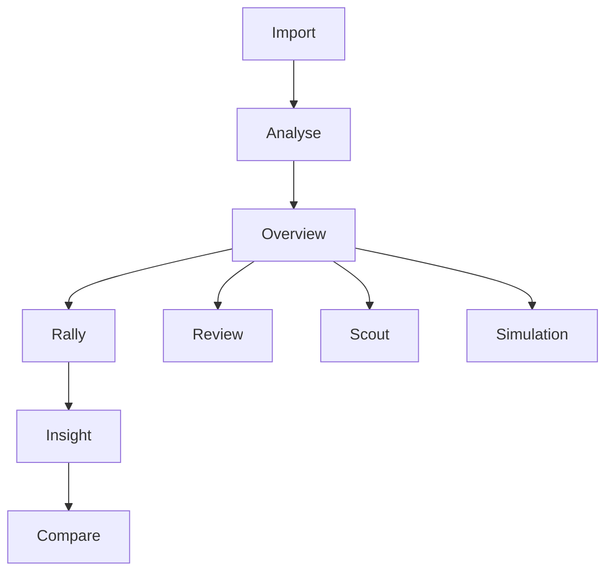

# Track 14: The visual language of the product

## Verdict

Build a **video-first replay instrument**: the source clip is the evidence, a court diagram is the second view, and every insight opens the exact moment behind it. After analysis, show one useful insight with one visual. Let players tap into the rally, compare clips, or inspect uncertainty instead of reading a dashboard of text.

That visual grammar can work across sports and across the mobile app, SDK, and embedded components. The display changes with the sport’s court and scoring rules; the meaning of a trail, map, clip, or confidence mark stays consistent.

Sources below were checked live on 2026-10-10. Older references are dated in the text. Design choices are recommendations, not claims that the team’s video models can already produce them.

## What to borrow from the references

| Reference | Verified example | Design lesson |
|---|---|---|
| **Hawk-Eye and tennis broadcasts** | HawkAR describes real-time AR graphics for metrics such as speed, acceleration, shot power, and player position. Its 2026 Wimbledon Inclusive Feed paired high-contrast shot paths and bounce points with synchronized audio. [HawkAR](https://www.hawkeyeinnovations.com/hawkar), [Inclusive Feed](https://www.hawkeyeinnovations.com/news/4550217/redefining-accessibility-in-tennis-with-hawkar-inclusive-feed) | Put a visual on the source video when it helps explain the play. Treat accessibility as another way to communicate the same event. |
| **BWF and ITTF** | A BWF World Tour manual from 2023 describes Hawk-Eye review, calibration, and smash-speed displays. BWF’s 2015 annual report describes shuttle-placement plots and speed graphics. ITTF’s 2023 annual report records AI-generated match stats at select events; its 2025 Table Tennis Review announcement covers review decisions. [BWF manual](https://media.ffbad.org/Nyi48/annexe1_-_bwf_world_tour_tv_production_guidelines_v2.pdf), [BWF annual report](https://system.bwfbadminton.com/documents/folder_1_81/folder_1_82/folder_1_93/6.%20Annual%20Report%202015.pdf), [ITTF annual report](https://db.ittf.com/sites/default/files/public/2025-05/2023AnnualReport.pdf), [ITTF review system](https://www.ittf.com/2025/04/13/enhanced-table-tennis-review-system-to-feature-at-ittf-mens-and-womens-world-cup-macao-2025/) | Racket-sport views benefit from placement, speed, and review evidence. These professional systems use dedicated court coverage and calibration; they are references for visual communication, not evidence that one phone camera can match their decisions. |
| **ATP and Tennis TV** | ATP Tennis IQ describes interactive court graphics, play-pattern analysis, opponent scouting, and later video tools. ATP Media’s Sony partnership introduced HawkAR to ATP coverage at the 2025 Finals. [Tennis IQ](https://www.atptour.com/en/news/atp-tdi-unveil-tennis-iq-analytics-platform), [2025 Tennis IQ update](https://www.atptour.com/en/news/atp-pif-tennis-iq-2025-announcement), [ATP Media and Sony](https://www.atpmedia.tv/article/sony-and-atp-media-enter-multi-year-strategic-partnership/) | A court graphic should be an entry point into a specific rally or pattern, not a dead-end chart. |
| **NBA and NFL Next Gen Stats** | NBA Stats offers shot-location and zone views. Second Spectrum’s CourtVision example put live shot probabilities and player stats into alternate viewing modes. NFL Next Gen Stats describes location, speed, and acceleration captured using venue equipment and player tags. [NBA Stats](https://www.nba.com/stats/quicklinks), [CourtVision](https://www.geniussports.com/customer-stories/test-clippers-and-genius-combine-to-power-ground-breaking-clippervision/), [NFL tracking](https://edge-operations.nfl.com/game-operations-logistics/technology/performance-tracking-data-next-gen-stats) | Keep analysis optional and layered. NFL tracking is a visual reference, not a realistic performance target for one phone camera. |
| **F1 TV** | F1 TV lists live driver maps, telemetry, and timing views. [F1 TV](https://www.formula1.com/en-us/subscribe-to-f1-tv) | Combine video with a map and a compact timeline when the user asks for detail. Keep that instrument panel one tap away, not on the first screen. |
| **Strava, WHOOP, Oura, Apple Fitness** | Strava’s Global Heatmap condenses activity into a map. WHOOP describes scores at a glance that open into deeper views. Oura presents a Readiness Score with contributing signals. Apple documents Activity rings as a progress visualization. [Strava Heatmap](https://support.strava.com/en-us/articles/15401880-what-are-the-global-heatmap-and-strava-metro), [WHOOP home screen](https://www.whoop.com/us/en/thelocker/the-all-new-whoop-home-screen/), [Oura Readiness](https://ouraring.com/blog/readiness-score/), [Apple Activity rings](https://developer.apple.com/design/human-interface-guidelines/activity-rings) | Lead with a single takeaway, then let a tap reveal contributing evidence and trends. |
| **Nothing, Teenage Engineering, sports games** | Nothing’s Phone (3) uses its Glyph Matrix for functional and playful animations. Teenage Engineering describes OP-1’s color-coded controls and real-time graphical interface. The TopSpin 2K25 manual identifies its score box, stamina display, and timing meter. [Nothing Phone (3)](https://np.nothing.tech/products/phone-3), [OP-1 interface](https://teenage.engineering/products/op-1/original/overview), [TopSpin manual](https://cdn.2k.com/topspin/topspin-2k25/manuals/ps4/2KSWIN_TOPSPIN_2K25_PS4_Online_Manual_ENG.pdf) | Give the interface a tactile identity and game-like immediacy. Use dots, color, and meters to carry meaning instead of adding decorative labels everywhere. |

**UNVERIFIED:** I did not verify the exact BWF or ITTF broadcast graphic packages currently in use in 2026. The BWF examples above are explicitly from 2015 and 2023; the ITTF examples are from its 2023 report and 2025 review announcement. Nothing’s current 2026 OS typography rules were also not verified. Borrow a dot-grid motif, not its proprietary font.

## Visual primitive catalogue

Each visual should answer one question, open the relevant clip, and show how certain its evidence is.

| Primitive and question | Visual and interaction | Reference |
|---|---|---|
| **Shot placement map:** Where did my shots go? | Top-down court with one mark per shot, direction arrow, count, and filters by shot type or rally. Tap a mark to seek the video. | [ATP Tennis IQ](https://www.atptour.com/en/news/atp-tdi-unveil-tennis-iq-analytics-platform), [BWF placement plots](https://system.bwfbadminton.com/documents/folder_1_81/folder_1_82/folder_1_93/6.%20Annual%20Report%202015.pdf) |
| **Landing heat map:** Where does the ball or shuttle usually land? | Court divided into zones or soft contours. Show the sample count and selected match/rally range; do not imply precision beyond the data. | [BWF stats examples](https://system.bwfbadminton.com/documents/folder_1_81/folder_1_82/folder_1_93/6.%20Annual%20Report%202015.pdf), [NBA shot zones](https://www.nba.com/stats/quicklinks) |
| **Court coverage heat map:** Which areas did I cover or leave open? | Separate heat layers for each player, based on rally frames. Distinguish court occupation from between-point movement. | [ATP Tennis IQ](https://www.atptour.com/en/news/atp-tdi-unveil-tennis-iq-analytics-platform), [HawkAR](https://www.hawkeyeinnovations.com/hawkar) |
| **Movement trail:** How did I recover after that shot? | A short player path with a start marker, turn points, and a clear end position. Limit trails to the selected rally. | [HawkAR](https://www.hawkeyeinnovations.com/hawkar), [Second Spectrum example](https://www.geniussports.com/customer-stories/test-clippers-and-genius-combine-to-power-ground-breaking-clippervision/) |
| **Ball or shuttle trail with speed color:** How fast did it travel, and where? | A trail keyed to a labeled speed scale, with units and confidence. If speed is not reliable, show a plain trail or no trail. | [HawkAR](https://www.hawkeyeinnovations.com/hawkar), [BWF manual](https://media.ffbad.org/Nyi48/annexe1_-_bwf_world_tour_tv_production_guidelines_v2.pdf) |
| **Rally-length barcode:** Which points were long, short, or decisive? | One compact segment per point; segment length or ticks indicate shots/hits. Color or icon marks the outcome. Tap to play that rally. | [ATP stats](https://www.atptour.com/stats/), [TopSpin HUD](https://cdn.2k.com/topspin/topspin-2k25/manuals/ps4/2KSWIN_TOPSPIN_2K25_PS4_Online_Manual_ENG.pdf) |
| **Momentum and score worm:** When did the match swing? | A point-by-point score trace with game/set breaks and the video timeline below. Call it “momentum” only if the underlying metric is defined and shown. | [ATP stats](https://www.atptour.com/stats/), [F1 timing view](https://www.formula1.com/en/timing/f1-live) |
| **Synced clip comparison:** What happened, and what is a better alternative? | Two real clips with a shared scrubber and matching play markers. Use landscape for side-by-side; stack the clips in portrait instead of shrinking them. | [ATP video and scouting tools](https://www.atptour.com/en/news/atp-pif-tennis-iq-2025-announcement), [CourtVision](https://www.geniussports.com/customer-stories/test-clippers-and-genius-combine-to-power-ground-breaking-clippervision/) |
| **Ghost overlay:** How does this movement compare with another rally? | A translucent prior path behind the selected path. Let the user switch the comparison clip and clear the overlay. | [CourtVision](https://www.nba.com/clippers/clippers-introduce-revolutionary-technology-launch-clippers-courtvision-digital-viewing-experience) |
| **Freeze-frame telestration:** Where should I look or aim? | Pause the actual frame, then draw an arrow and target zone on it. Link the arrow to the corresponding court location. Distinguish user-drawn marks from model suggestions. | [ITTF review system](https://www.ittf.com/2025/04/13/enhanced-table-tennis-review-system-to-feature-at-ittf-mens-and-womens-world-cup-macao-2025/), [Hawk-Eye Inclusive Feed](https://www.hawkeyeinnovations.com/news/4550217/redefining-accessibility-in-tennis-with-hawkar-inclusive-feed) |
| **2.5D rally replay:** How did the rally unfold spatially? | Court plane plus simplified player markers and a ball/shuttle path. Label it as a reconstruction; do not present estimated depth as observed video. | [HawkAR](https://www.hawkeyeinnovations.com/hawkar), [ATP Immersive Highlight](https://www.atptour.com/en/news/alcaraz-nitto-atp-finals-2024-wednesday-immersive-highlight) |
| **Confidence visual:** How certain is this point or path? | Solid line for stronger evidence, dashed segments for estimates, and an uncertainty ellipse for a landing area. Include a short status such as “uncertain.” | [Hawk-Eye Inclusive Feed](https://www.hawkeyeinnovations.com/news/4550217/redefining-accessibility-in-tennis-with-hawkar-inclusive-feed); uncertainty encoding is a design recommendation. |
| **Player card:** What should I know about this player? | One image or initials, match context, a few visual strengths, and sample counts. Tap a strength to see its rallies. | [ATP Tennis IQ scouting](https://www.atptour.com/en/news/atp-tdi-unveil-tennis-iq-analytics-platform), [WHOOP score drill-down](https://www.whoop.com/us/en/thelocker/the-all-new-whoop-home-screen/) |
| **One-number hero stat:** What is the single useful takeaway? | Large number with its unit, denominator, and match context, beside the clip or map that supports it. Example only: “8 of 10 returns landed deep.” | [Oura Readiness](https://ouraring.com/blog/readiness-score/), [Apple Activity rings](https://developer.apple.com/design/human-interface-guidelines/activity-rings) |

## Information architecture and screen flow

The reference pattern is a concise at-a-glance view that opens into details on tap, as seen in WHOOP’s score dials and Oura’s score contributors. The proposal below applies that pattern to match evidence. [WHOOP](https://www.whoop.com/us/en/thelocker/the-all-new-whoop-home-screen/), [Oura](https://ouraring.com/blog/readiness-score/)

### Screen-by-screen visual spec

| Screen | Main visual | Interaction | Words |
|---|---|---|---|
| **Import** | Gallery video preview dominates. Small sport and court setup controls sit beside or below it. | Pick a clip, confirm sport, and tap court corners if required. | One clear instruction and a short runtime estimate only if measured. |
| **Analysing** | Video thumbnail with a court outline drawing over it. Progress is a set of real stages, such as “Finding court” and “Separating rallies.” | Let the user review or correct sport/court setup while processing. | Stage labels. Do not show a made-up percent complete. |
| **Match overview** | Match identity and score, one hero insight, and one visual such as a court map or selected clip frame. | Tap the visual to open its rally. A compact rally barcode can sit below the first view. | One caption at most. If the data is weak, lead with a useful clip instead of inventing an insight. |
| **Rally** | Video first, with a scrubber and rally barcode. A compact court map tracks the selected point. | Scrubbing video moves the court marker; tapping the court marker seeks the video. | Labels for the selected shot and confidence only. |
| **Insight** | The exact evidence clip beside or above its court map, with the relevant path or landing zone emphasized. | “Watch the rally” and tap-through to supporting points. | One data-backed caption, such as “Your second serve went wide in 6 of 10 points.” This is an example format, not a result. |
| **Clip compare** | Two clips share a playback position. Side-by-side in landscape; stacked in portrait. | One scrubber controls both clips; tap to replay either clip alone. | “Your rally” and “Try this” or similarly plain labels. Use team-recorded or properly licensed clips. |
| **Referee review** | Frozen source frame plus replay controls and a landing uncertainty ellipse on the court. | Inspect the frame, toggle the court view, and confirm or reject an assistive suggestion. | Provisional “in,” “out,” or “uncertain” status, with an explicit confidence label. No automatic score change. |
| **Opponent scout** | Player card, repeated shot-direction or placement patterns, and a strip of supporting clips. | Tap a pattern to play its rallies; filter to a serve, return, or rally phase. | One-line summaries that include sample counts. |
| **Simulation** | Freeze at opponent contact. Show the court as a tappable target, then resume the actual clip. | User picks a destination; playback reveals the rally outcome, followed by a visual comparison. | One-line result grounded in the observed clip. |

**Footage note:** The comparison should use actual, comparable clips. The team can film an “observed action” and a “try this” example at college. The license status of commercial match footage is **UNVERIFIED**, so do not build the demo around clips that the team does not have permission to use.

## Visual tokens, accessibility, and motion

### Color and type

Proposed starting palette:

| Token | Color | Use |
|---|---|---|
| Ink | `#101519` | Main background |
| Surface | `#1D272D` | Panels and opaque label backing |
| Chalk | `#F3F0E8` | Main text and court marks |
| Ice blue | `#62C7D5` | Player A or selected path |
| Warm orange | `#F39B68` | Player B or comparison path |
| Ball citron | `#DCE76B` | Single key action or outcome highlight |

On flat swatches, calculated contrast is 16.1:1 for chalk on ink, 13.4:1 for chalk on surface, and at least 8.5:1 for the accent colors on ink. These are candidate token ratios, not a guarantee over moving footage. Use opaque label backing and a contrasting halo on video overlays. WCAG 2.2 sets a 4.5:1 contrast threshold for normal text and 3:1 for large text; it also addresses contrast for meaningful non-text graphics. [W3C text contrast](https://www.w3.org/WAI/WCAG22/Understanding/contrast-minimum), [W3C non-text contrast](https://www.w3.org/WAI/WCAG22/Understanding/non-text-contrast)

Use **IBM Plex Sans** for interface text and **IBM Plex Mono** sparingly for scores, timestamps, and stat values. IBM describes Plex as open source under the Open Font License, and Plex Sans includes Devanagari support. Use a dot-grid as a small visual motif for score ticks or recording states; keep it out of body copy. [IBM Plex](https://github.com/IBM/plex/)

For heat maps, use a sequential, perceptually uniform palette such as **Cividis** and add counts or direct labels. For player identity, pair color with line style, markers, and labels. Never make color the only way to distinguish players or confidence. The Cividis research reports similar interpretation for viewers with and without red-green color-vision deficiency. [Cividis paper](https://arxiv.org/abs/1712.01662)

### Motion and haptics

- **Video to court view:** Pause on the selected frame, trace the court corners, then transform the same moment into a top-down court. Keep the selected player or shot anchored through the transition. If the court transform is uncertain, show a simple schematic and label it as estimated.
- **Court to clip:** A tapped marker seeks to the corresponding source-video time. That spatial-to-temporal connection is the core navigation gesture.
- **Compare:** Keep both clips synchronized through a single scrubber. Use the same highlight color for the selected action in both clips.
- **Android haptics:** Use a light tick when scrubbing snaps to a frame or simulation zone, and a distinct confirmation when the user commits a choice. Keep feedback sparse, consistent, and supported by a fallback. Android’s haptics guidance recommends restrained use and consistent action feedback. [Android haptics principles](https://developer.android.com/develop/ui/views/haptics/haptics-principles)
- **Reduced motion:** Make essential changes understandable without animation, and respect the user’s reduced-motion preference. W3C explains that non-essential interaction-triggered motion should be disableable. [W3C animation guidance](https://www.w3.org/WAI/WCAG22/Understanding/animation-from-interactions)

### Where an LLM writes words

The LLM may write **one line only**, from structured match data. It can phrase a supported observation; it cannot create a score, speed, confidence, ruling, or opponent tendency. Show the source count and link the caption to the clip. If the evidence is insufficient, show a concise status such as “Not enough video detail to assess speed.”

## Ten rules for designers and agents

1. Start with the video or court picture, not a paragraph.
2. Show one primary insight on the first post-analysis screen.
3. Every insight must open its supporting rally.
4. Show the denominator and sample size with rates and percentages.
5. Use solid, dashed, and uncertainty marks to distinguish evidence states.
6. Do not show ball or shuttle speed unless the estimate is reliable.
7. Use sport-specific court geometry, even when the visual primitive is shared.
8. Sync video, court marker, and rally timeline to the same event time.
9. Use one-line captions generated only from structured evidence.
10. Keep referee output provisional unless the system has earned a stronger claim.

For the player app, SDK, and embedded components, use the same primitive names and states. A shared visual contract should carry the sport court, event time, coordinates, confidence, and evidence clip, then let each surface render that event in its own layout. That gives the product a stronger visual moat than a dot font: each recommendation leads back to evidence, with uncertainty visible.

## 1. Recommendation

Make the first polished story **Import → Overview → Rally → Insight → Clip Compare**. Center it on an exact source clip, a court view, and an honest confidence mark. Make side-by-side comparison the signature moment, with landscape comparison and a stacked portrait layout.

Build referee review as an assistive view. BWF’s 2023 manual describes professional Hawk-Eye court coverage and calibration, which is materially different from a single phone camera. Do not present a one-camera estimate as an official line call. [BWF World Tour Manual](https://www.g2b.go.kr/pn/pnp/pnpe/UntyAtchFile/downloadFile.do?bidPbancNo=R25BK00741472&bidPbancOrd=000&fileSeq=3&fileType=)

This track recommends no rendering library, model, or API version. The only font recommendation is open-source IBM Plex. No paid video or hosted service is required for the visual system.

## 2. Three biggest risks

1. **The phone clip may not support the promised visuals.** Reliable contact, shuttle or ball trails, and speed may be missing from low-resolution footage. Treat those outputs as conditional, not guaranteed.
2. **A confident-looking referee screen can overstate the evidence.** A polished “in” or “out” mark can imply professional-grade officiating even when the model is uncertain. Keep the confidence and source frame visible.
3. **The demo depends on comparable clips and a readable phone layout.** Use team-recorded or properly licensed footage. Side-by-side portrait video may be too small, so demonstrate comparison in landscape and preserve a stacked portrait view.

## 3. Open questions only your team can answer

- Which sport and exact college clip will anchor the demo?
- Is the first user story for a player, coach, or tournament official?
- Which two comparable actions can the team record, and may those clips be shown to judges?
- Should referee review remain a provisional assistant, or is the team considering a stronger officiating claim?